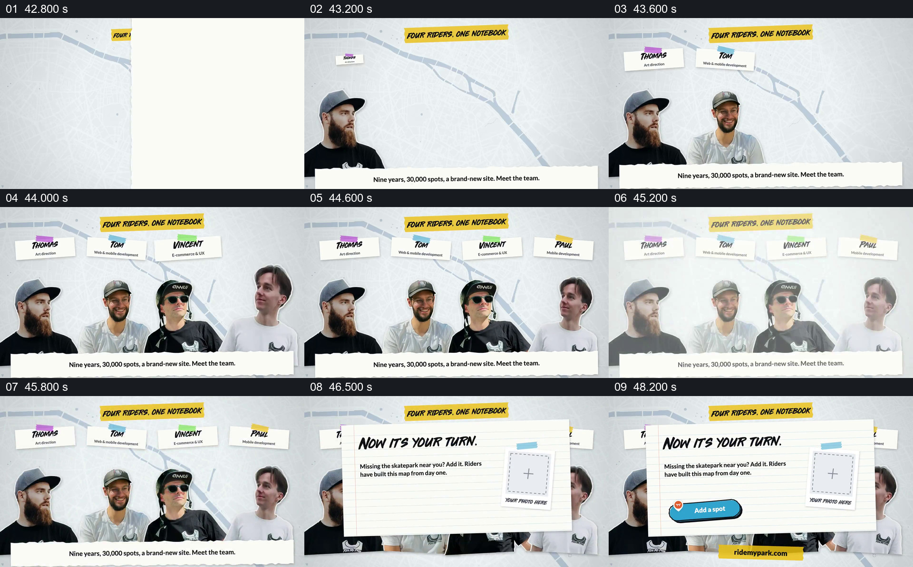

# 让团队逐一归位，再把参与入口放到他们面前

- 作品：案例 002《分批进入与横向遮挡接续》（库内索引名）。
- 原片范围：00:42.700–00:51.626，含起点、不含终点；[完整原片](../video.mp4)｜[本卡片段](c08.mp4)。片段内时间从原片 42.700 秒开始。
- 边界依据：从团队成员开始集结到邀请页、照片占位与添加入口稳定呈现，并保留片尾。
- 观察方式：核看完整原片 64 帧总览及本卡九宫格，并在 00:44.4–00:46.6 对约每 0.2 秒源帧做加密核对。未独立完成连续原速观看与听审；精确运动、停顿、声音落点和新题材迁移效果仍待核验。作品中的年份、人物关系与数字仅按画面呈现记录，未独立查证。

## 原画面具体怎样设计

**先建立团队集合。** 白色纸面退开后，地图底纹上方出现“FOUR RIDERS, ONE NOTEBOOK.”，Thomas、Tom、Vincent、Paul 四个人物剪影先后排列成一排；每人上方有姓名和职责小卡。底部纸条写着九年、30,000 个地点、新网站与团队介绍。到约 00:44.6，四人及四张职责卡共同可见。

**保留团队，再把观看任务交给新纸页。** 约 00:45.2，源帧短暂变得发白，随后团队画面重新清楚；约 00:46，较大的横线纸页出现在中央前景，遮住四个人物上半身的中间部分，左右边缘和下方仍能看到他们。前景标题为“NOW IT’S YOUR TURN.”，下方文字邀请观众补充附近缺失的滑板场；右侧是写有“YOUR PHOTO HERE”的照片占位框。

**给出可执行入口。** 在同一前景纸页下部，蓝色“Add a spot”按钮与地点图标出现，画面底部还有 ridemypark.com。后方地图背景、上方团队标语和成员边缘继续构成参照，注意力由团队集合转向前景的邀请、占位与按钮，最终保留可供理解的行动结果。

## 为什么这样设计，好在哪里

这段先让每位成员与职责各自出现，再把他们放成团队；前景邀请页随后占据中央，却没有把人物彻底移走。因而“团队做了什么”仍是背景参照，观众接收到的下一步是加入同一项工作。只展示按钮会缺少参与场景，只保留团队合照又没有具体行动入口。

照片占位和“Add a spot”把参与方式从抽象倡议变成可以辨认的对象；同一页上的提示文字解释什么时候需要贡献。按钮和网址在片中可见，不证明当前网站仍可用或提交功能已被本次验证。

## 完整照排指令

以[本地原片](../video.mp4) 42.700–51.626 秒为准，16∶9，1280×720，30 帧/秒。位置按画幅百分比取近似值，拍点精度受抽帧间隔限制。

### 用料

- 【街网底图】低反差灰底斜河道。【团队肖像一】【团队肖像二】【团队肖像三】【团队肖像四】为本段同一团队的四位真实成员，可抠出半身并统一视线与底线，优先复用前段已经介绍过的裁切。
- 【成员姓名一】【成员姓名二】【成员姓名三】【成员姓名四】及相同序号的【成员职责一】【成员职责二】【成员职责三】【成员职责四】，须回指各头像。【团队标题】【团队说明】简短，后者的年数或地点总量附团队页面、可打开的历史资料以及口径日期。
- 【参与标题】【参与说明】【占位说明】【按钮文字】【参与网址】共同指向确实可做的下一步，提供对应页面。占位框保留加号；若替换成已提供的提交通道预览，保留小尺寸和独立下签。

### 按源时刻摆放

1. **42.700–约 44.300 秒。** 白色遮板从画右退出后，满铺【街网底图】，画顶正中出现短黄贴，粗黑斜体【团队标题】。从左到右依次加【团队肖像一】【团队肖像二】【团队肖像三】【团队肖像四】，共同占 x2%–96%，y38%–86%，前者保留原位。各人上方独立斜白纸，依序排【成员姓名一】【成员姓名二】【成员姓名三】【成员姓名四】，下一行各置对应【成员职责一】【成员职责二】【成员职责三】【成员职责四】。四人卡用紫、蓝、绿、黄短贴分别标记。底部满宽白撕边纸居中排小黑【团队说明】，贴住四人的下沿。
2. **约 44.300–45.900 秒。** 留团队整幅读完，约 45.1 秒出现一次很浅的短闪；随后把一张白撕边【参与标题】卡从画顶压入。它从较高位置落到 x13%–91%、y20%–83%。保留黄标题、靠上的部分姓名签和左右、下方的肖像残边，使观众还能辨认白卡压在团队前景。四组人像为静态，可以平移抠图。
3. **约 45.900–48.100 秒。** 新纸左上黑色粗斜【参与标题】一行，下面两行小号左齐【参与说明】。右半靠上贴青蓝胶带，下放竖向细框和细灰十字，框下小黑【占位说明】；加号和说明保持到结束。约 47 秒左下出现蓝色圆角【按钮文字】，白字居中，左端接一枚橙圆小标。随后白纸底沿外加黄贴【参与网址】，字粗黑，置中。
4. **约 48.100–51.626 秒。** 让白纸、钮、网址在同一画面稳定到最后一帧。团队继续被前纸遮住中部，边缘仍作为背景。禁用全幅白底清除四人。到源片尾切出，无需添加转场。

### 局部采用

团队材料齐全时可只用 42.700–约 45.500 秒，留四人对齐后切出。只有参与入口时，可截取约 47.700–51.626 秒的稳定告示，介绍团队的效果仅在已有前情时成立。

### 验证状态

本轮以 5 帧/秒原片画序检查 44.300 秒前后团队积累、45.900 秒前纸压住肖像、约 47–48 秒按钮先于网址陆续出现。片尾留存关系已对稿，连续原速、逐帧边界、听审和换料待核。
