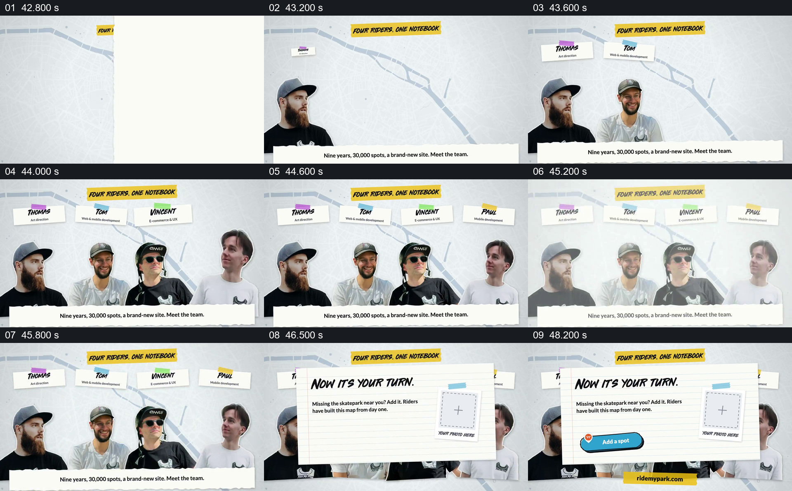

# 团队逐个归位后，把贡献入口交给观众

- 作品：案例 002《分批进入与横向遮挡接续》（索引名称）。
- 原片范围：00:42.700–00:51.626，含起点、不含终点；[完整原片](../video.mp4)｜[本卡完整片段](c08.mp4)。
- 观察方式：按整片 64 宫格顺序检查，并在原片各段约每秒抽帧、对交界加密观察；本卡分镜为原片真实帧。未连续原速观看或听审，声音内容与语气未确认。

## 原画面具体怎样设计

地图底纹上的标题写着“四位骑行者，一个笔记本”，四位已在前面出现的人物依次并排，头顶分别出现姓名与职责，底部文字回顾项目历程并介绍团队。随后一张大的横线纸卡落在人物前方，标题变为“现在轮到你”，卡内说明缺少附近滑板场时可以添加，右边是“你的照片放这里”的占位框，左下出现“Add a spot”按钮，最下方补出网站地址；人物仍从卡片边缘露出。

## 为什么这样设计，好在哪里

先让负责的人组成完整团队，再把邀请放在前景，画面把项目的既有建设者与下一位贡献者联系起来。照片占位与具体按钮使邀请指向一种可理解的参与方式，团队没有完全消失，原有身份也得以延续。按钮是视频中的图形，不能据此确认当前网站仍提供同一功能。 以上为作品分析，不代表作者自述或已测量的观众反应。

## 可直接使用的创意指令

当团队项目确实接受外部参与，且已有明确可用的入口和贡献方式时，先展示负责人的身份与各自作用，形成可辨认的团队整体；随后在团队仍可辨认的前景引入邀请，说明观众可以补充什么、怎样提交，并用与真实入口一致的按钮、地址或示意展示下一步。保留与前文成果的联系，避免把泛泛的“参与”写成观众无法执行的行动。人物数量、界面与布局可调整；上线前核对入口、权限和材料要求，视频里的示意按钮不等于实际可点击功能。
