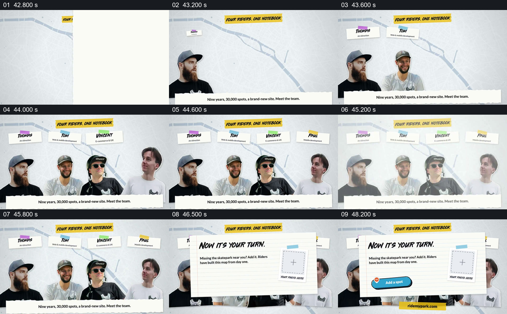

# 让团队逐一归位，再把参与入口放到他们面前

- 作品：案例 002《分批进入与横向遮挡接续》（库内索引名）。
- 原片范围：00:42.700–00:51.626，含起点、不含终点；[完整原片](../video.mp4)｜[本卡片段](c08.mp4)。片段内时间从原片 42.700 秒开始。
- 边界依据：从团队成员开始集结到邀请页、照片占位与添加入口稳定呈现，并保留片尾。
- 观察方式：核看完整原片 64 帧总览及本卡九宫格，并在 00:44.4–00:46.6 对约每 0.2 秒源帧做加密核对。未独立完成连续原速观看与听审；精确运动、停顿、声音落点和新题材迁移效果仍待核验。作品中的年份、人物关系与数字仅按画面呈现记录，未独立查证。

## 原画面具体怎样设计

**先建立团队集合。** 白色纸面退开后，地图底纹上方出现“FOUR RIDERS, ONE NOTEBOOK.”，Thomas、Tom、Vincent、Paul 四个人物剪影先后排列成一排；每人上方有姓名和职责小卡。底部纸条写着九年、30,000 个地点、新网站与团队介绍。到约 00:44.6，四人及四张职责卡共同可见。

**保留团队，再把观看任务交给新纸页。** 约 00:45.2，源帧短暂变得发白，随后团队画面重新清楚；约 00:46，较大的横线纸页出现在中央前景，遮住四个人物上半身的中间部分，左右边缘和下方仍能看到他们。前景标题为“NOW IT’S YOUR TURN.”，下方文字邀请观众补充附近缺失的滑板场；右侧是写有“YOUR PHOTO HERE”的照片占位框。

**给出可执行入口。** 在同一前景纸页下部，蓝色“Add a spot”按钮与地点图标出现，画面底部还有 ridemypark.com。后方地图背景、上方团队标语和成员边缘继续构成参照，注意力由团队集合转向前景的邀请、占位与按钮，最终保留可供理解的行动结果。

## 为什么这样设计，好在哪里

这段先让每位成员与职责各自出现，再把他们放成团队；前景邀请页随后占据中央，却没有把人物彻底移走。因而“团队做了什么”仍是背景参照，观众接收到的下一步是加入同一项工作。只展示按钮会缺少参与场景，只保留团队合照又没有具体行动入口。

照片占位和“Add a spot”把参与方式从抽象倡议变成可以辨认的对象；同一页上的提示文字解释什么时候需要贡献。按钮和网址在片中可见，不证明当前网站仍可用或提交功能已被本次验证。

## 可直接使用的创意指令

当真实项目需要从团队成果介绍转到公众参与时，先准备人员或群体、各自角色及共同成果的可靠信息，让成员逐一建立后形成能被辨认的整体。再把当前任务所需的邀请放到前景，允许团队或原有工作场景作为背景参照继续存在，使参与对象和发起者保持关系。

在邀请中明确观众要补充什么、通过哪个实际入口行动，以及需要提交的材料；以相应的按钮、表单或真实载体承载下一步。人物可换成组织、作品或社区成员，纸页和照片占位也可换成适合当前内容的形式；需要保留团队或成果与具体行动之间的可理解交接。仅有宣传口号、没有可执行入口时，应如实呈现，而不伪装成可提交的功能。
