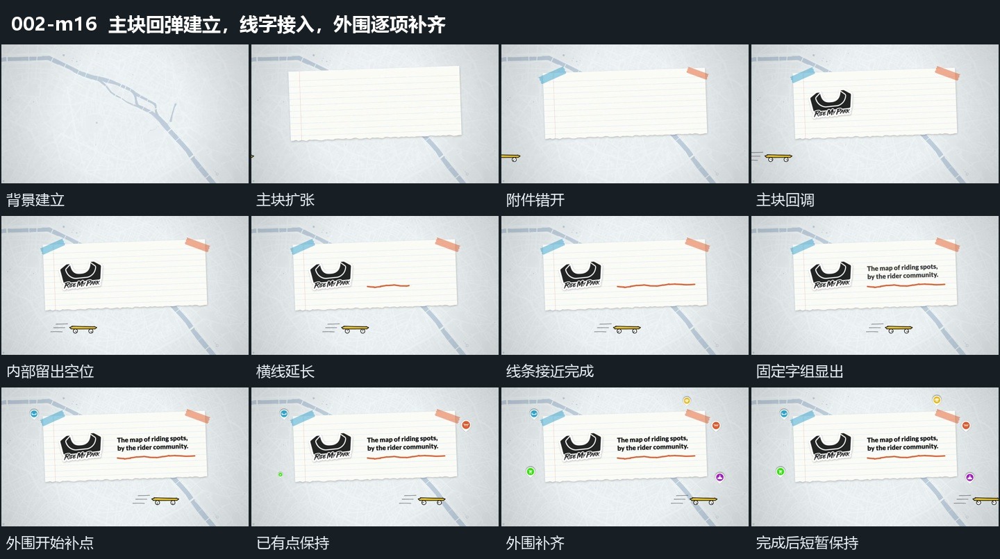

# 主块回弹建立，线字接入，外围逐项补齐

## 运动指令

- 起始与主块建立：保持背景，中央横矩形从小尺寸扩大，越过停留尺寸再缩回。上沿两小片和块内小形状错开扩张、回调，不同时弹出。

- 内部接力：主块接近稳定后，在其内部让横线从短到长延伸；线条接近完整，固定字组才由隐到显。文字在原位置出现，不跟着线头横移。

- 外围补齐：在线字已可见的基础上，让外围点沿空间顺序一个接一个扩大并回调。新点加入时已有点继续保持，最后形成围绕主块的完整分布。

- 并行与收束：底部细长小物在上述过程里持续由左向右通过，不等待每个步骤结束。外围补齐后保留整组轻微浮动和阅读停留，短暂展示完成状态后结束切片。

- 观察位置：画面取景保持，变化来自各层自己的缩放、显隐和位移，没有把镜头推近当成主块放大。

## 视频切片

[播放本机制的原片切片](m16.mp4)

从背景已显出、主块尚未建立时开始；完整保留回弹、线字接力与外围补齐，短暂展示完成状态后结束，不再延长重复浮动和底部往复通过。

## 分镜过程

## 组合与调整

复用时先确定中心承载，再安排内部完成和外围收束。可改变元素数量、间隔和回调幅度；保持“承载接近稳定→线字接入→外围完成”的接力，不把各步骤重置成新的空画面。
