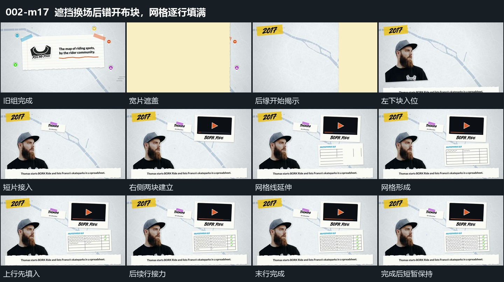

# 遮挡换场后错开布块，网格逐行填满

## 运动指令

- 进入：宽片由左向右经过，先盖住旧组，在全遮挡时换掉底层，再由后缘露出新组。遮挡是本段的进入过程，不另外截成孤立片段。

- 建立相对布局：左下裁切块上升并扩大回调，底部横条同时上移。上方短片、右上矩形、右下矩形依次加入，各自落稳；前一个不必完全停止，后一个即可进入。

- 内部描画：右上块内的短线延长；右下矩形先保持空框，再让横向和纵向分隔线延伸，形成网格。其他块保持位置，仅有轻微浮动。

- 逐行填满：网格成形后，各行内部短线从上到下依次增加，同一行的末端符号随后接入。填过的行留在原位，直到最后一行完成。

- 完成与运镜：保留填满后的整个布局，短暂展示完成状态后结束切片。观察位置固定，网格描画与填充都发生在外框内部。

## 视频切片

[播放本机制的原片切片](m17.mp4)

保留横向遮挡、新布局建立和网格逐行填满；末行及末端符号完成后短暂展示结果，删去之后的重复保持。

## 分镜过程

## 组合与调整

可替换布块数量和网格行列，但外框应先建立，再发生有方向的内部累积。前段的出口由宽片接走；用于新片时重新匹配全遮挡瞬间，不在未遮严时换底。
