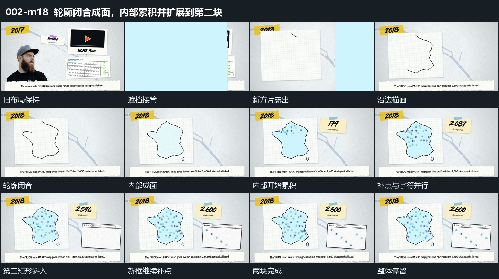

# 轮廓闭合成面，内部累积并扩展到第二块

## 运动指令

- 换场与承载：宽片横向遮住旧组并揭示新底层。左侧方片和上方短片先建立，底部横条同时从下边界上移。

- 从线到面：在方片内部沿边延长折线，直到首尾闭合。闭合时内部块面接入，轮廓不因填充而重新消失或重画。

- 首次累积：闭合区域内的小点依次扩大、回调并保留；右上短片扩张落位，内部字符在补点时持续更换。两者并行，不把每一次字符变化写成某一点的触发。

- 继续展开：左侧已经建立的区域保持，第二矩形从右下斜向进入并回调。新框落稳过程中，其内部的小点依次补入，把同一建立过程延续到右侧。

- 完成与运镜：两块的内部累积完成后保持整体，直到下一次遮挡。取景固定，局部点增加不对应镜头移动。

## 视频切片

[播放本机制的原片切片](m18.mp4)

从上一组完成状态开始，包含横向遮挡换场、新组的建立、内部发展和完成后的保持；在下一次遮挡前结束。

## 分镜过程

## 组合与调整

可调整轮廓形状和第二块的位置。保留“闭合后填面、填面后补点、旧结果保持时新框接入”的依赖；不把线条增长、填面、每次补点拆为单独片段。
