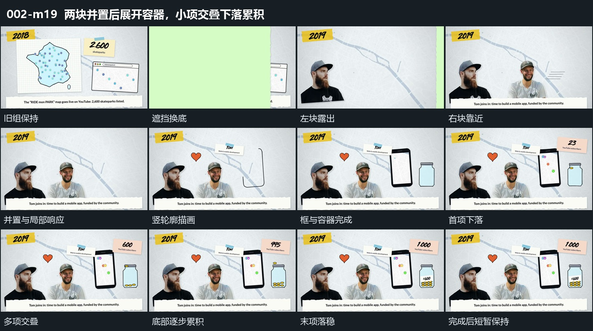

# 两块并置后展开容器，小项交叠下落累积

## 运动指令

- 进入与并置：横向宽片换场后，左下块先保持，另一块从右侧快速靠近，接近停留位置时减速，形成左右并置。底部横条同时升入。

- 局部响应与展开：上方小形状和短片错开扩张，小形状外的短线显出后减淡。右侧竖向轮廓沿边延长并闭合，旁边的容器与上方字符片随后接入。

- 下落接力：小椭圆从容器上方依次落下，进入容器并在底部停留。前一项还在下落或尚未落稳时，下一项已经进入；最早落下的项持续保留。

- 共同完成：容器内逐步堆积，上方字符片同时更换，竖框内部的小点也陆续出现。保留最后一项落稳后的结果，不在半空动作中截断。

- 运镜与退出：观察位置保持，各层仅作局部运动。整组轻微浮动，下一次遮挡才带走结果。

## 视频切片

[播放本机制的原片切片](m19.mp4)

保留换场、两块并置、轮廓和容器建立及连续下落；最后一项落稳、内部字符显出后短暂展示结果，删去之后的重复保持。

## 分镜过程

## 组合与调整

可改变累积数量、落点和错开幅度，但必须留出容器先建立及末项落稳的过程。并置和轮廓不是额外开场，都是为同一累积演出搭建持续参照。
