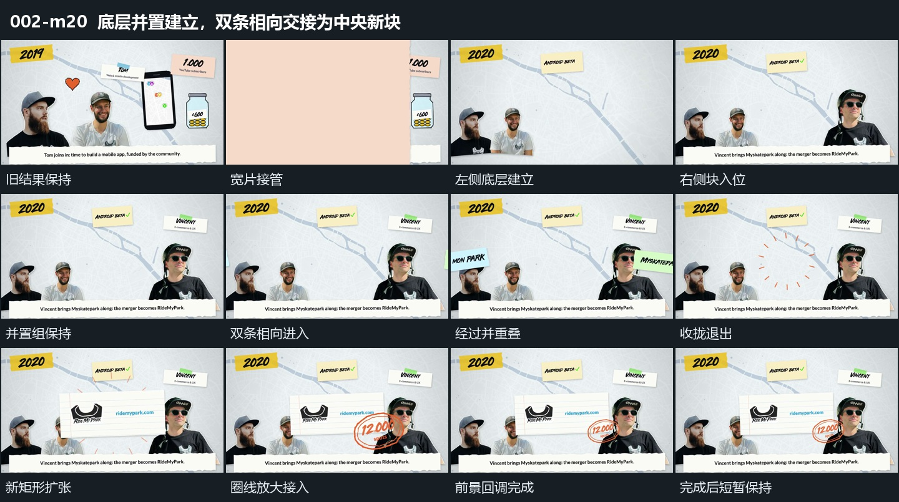

# 底层并置建立，双条相向交接为中央新块

## 运动指令

- 换场与布块：宽片横向遮挡后，左下两块、上方条片和底部横条错开建立。右侧裁切块扩大到略过停留尺寸再缩回，附近短片随后接入。

- 双条接力：底层布局保持，两条长片从相反边界朝中部移动，经过重叠后到达各自内侧位置，再次向中央靠拢并退去。

- 结果接管：双条退出后，中央放射短线出现；独立新矩形从小到大扩张、过位再回调，放射短线在后方散开并减淡。不能把这个替换写成双条连续形变为新矩形。

- 角部收束：中央矩形接近落稳后，右下圈线与内部字符作为一组以较大尺寸接入，再缩回。完整前景与底层共同保持，短暂展示结果后结束切片。

- 观察位置：全段取景固定，注意转移由前景进入和大小变化完成。

## 视频切片

[播放本机制的原片切片](m20.mp4)

保留换场、底层建立、双条相向与退出、新矩形接管和圈线回调；圈线落稳后短暂展示结果，删去后续较长浮动等待。

## 分镜过程

## 组合与调整

可改变双条来路与新块位置，但底层应持续存在，双条退去后再由新块接管。保留新块回调、圈线收束与结果停留，避免只截取两条碰面的中间动作。
