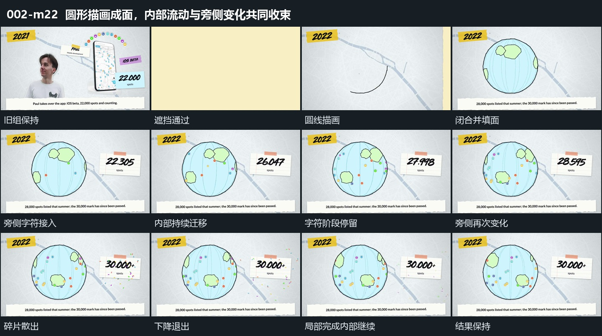

# 圆形描画成面，内部流动与旁侧变化共同收束

## 运动指令

- 进入与成形：宽片横向换场后，中央圆线沿边描出并闭合，内部曲线和块面接入；底部横条提前上升，与轮廓建立交叠。

- 建立伴随层：右侧矩形扩大回调，小点和字符分次增加。让圆形外边界保持尺度，内部块面持续改变横向位置，形成边界固定、内部流动的关系。

- 并行推进：内部继续迁移，右侧矩形内字符先停留再继续更换；外部观看位置和底层不跟着内部块面横移。

- 局部收束：旁侧增加附加符号，附近小碎片向外散出，再下降并退出。碎片退出时圆内运动仍然继续，不随局部变化停止。

- 结束：保留碎片消失、字符稳定而圆内仍流动的结果，到下一次遮挡前结束。这种完成状态允许内部持续运动，不必把所有对象都停住。

## 视频切片

[播放本机制的原片切片](m22.mp4)

从上一组完成状态开始，包含横向遮挡换场、新组的建立、内部发展和完成后的保持；在下一次遮挡前结束。圆内持续迁移保留至切片末尾，旁侧字符与碎片过程已完成。

## 分镜过程

## 组合与调整

复用时先分清固定边界和内部移动层，再安排旁侧递变。可调整迁移方向和碎片数量，但必须让旁侧变化从建立到结束完整呈现；不能只以持续运动尚未停止为由无限延长。
