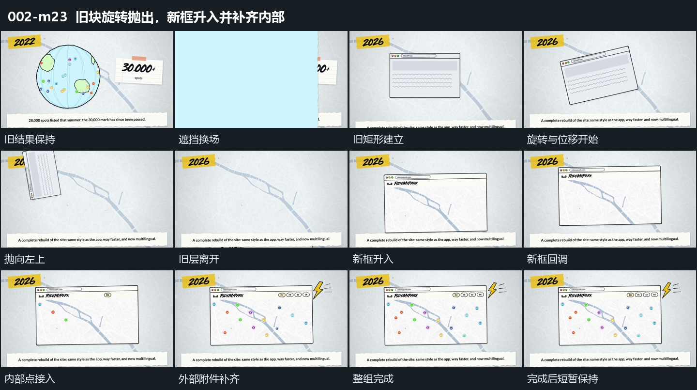

# 旧块旋转抛出，新框升入并补齐内部

## 运动指令

- 进入：宽片横向遮挡旧画面，退去后露出中央旧矩形。上方条片内部字符更换，底部横条同时上升。

- 旧块退让：保持底层和周边条片，令旧矩形逆时针旋转，并在角度快速变化时同时向左上移动，直到整块越过画面边界。

- 新框接替：中央短暂露出底层后，独立新框从右下升入，越过停留位后回调落稳。不是让已离开的旧块瞬间变回新框。

- 内部完成：新框接近稳定时，内部小点和上沿小项错开增加；外围折角形扩大后缩回。已建立的框一直保持，使内部和附件的接力属于同一段展开。

- 完成与运镜：保留新框内部和外围全部建立后的停留，短暂展示完成状态后结束切片。观察位置保持固定，旋转抛出由旧层自身承担。

## 视频切片

[播放本机制的原片切片](m23.mp4)

保留换场、旧块抛出、新框升入及内外附件接力；最后的外围折角形回调后短暂展示结果，删去后续重复浮动。

## 分镜过程

## 组合与调整

可更换退出边界和新框来路，但要保留旧层明确离开、空位短暂显露、新层进入并完成内部的顺序。不能在新框刚入位时就切掉尚在建立的内部点。
