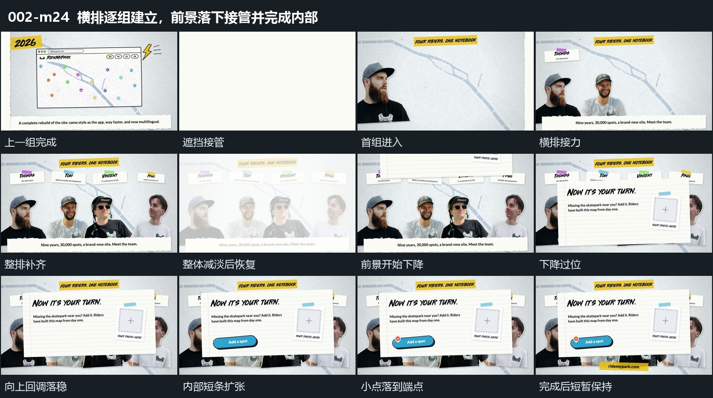

# 横排逐组建立，前景落下接管并完成内部

## 运动指令

- 换场与横排建立：宽片横向通过后，上方长条先出现。横向排列的各裁切块从左到右逐组加入，配套短条错开接入；前一组还在扩大回调，后一组已开始建立。

- 底层完成：横排补齐后整组保持，发生一次全组减淡与恢复，恢复的仍是原位置的同一集合，不把这次显隐视为另一个场面。

- 前景接管：大矩形从上方下降，越过停留位置再向上回调，盖住横排中部。外围和底部边缘仍可见，表明原集合继续作为底层存在。

- 内部接力：前景落稳后，内部胶囊形短条扩大、缩回；上方小点随后下降，停在短条左端。下方另一短条继续扩大回调，胶囊旁再补入小尖形符号。

- 收尾与运镜：所有部分建立后一起轻微上下浮动，短暂展示完成状态后结束切片，省略随后较长的重复浮动。取景固定，前景下降是对象运动；原片没有整体退场，不补写一个退出。

## 视频切片

[播放本机制的原片切片](m24.mp4)

保留横向遮挡、横排累积、前景下降回调，以及内部短条、小点和附属符号的完整建立；最后元素落稳后短暂展示结果，删去原片末尾较长的重复浮动。原片没有整体退场。

## 分镜过程

## 组合与调整

可调整横排组数和前景覆盖面积，保持“先有集合→集合成为底层→前景内部继续完成”的发展。最后小点落位是前景建立的收尾，不单独截成一个缺少承载的动效。
