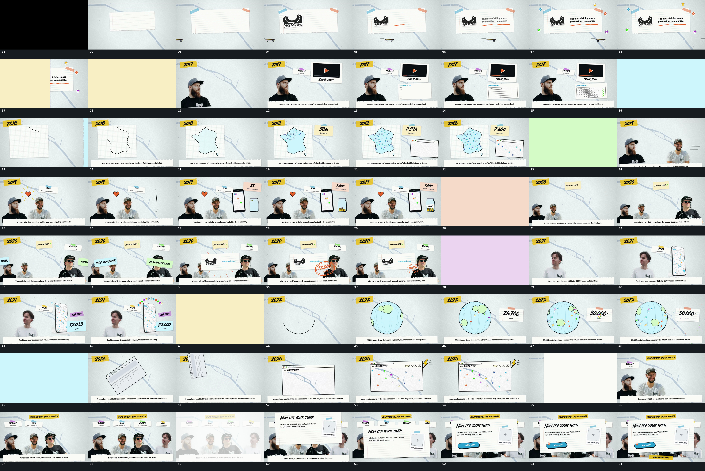

# 002｜原片运动总览

[观看完整原片](video.mp4)

本例重新按完整运动段落整理为九段。每段保留进入、发展与完成，小动作作为段内步骤，不再独立成为碎片卡片。重复的横向遮挡纳入下一段进入过程；前一段保留到完整结果并短暂展示，后一段从换场前的状态继续接走。切片省略两者之间没有新发展的等待，不要求各切片首尾无间隙地还原整片。全片取景基本保持，主要变化由画面内各层完成。

## 段落一｜主块回弹建立，线字接入，外围逐项补齐

[主块回弹建立，线字接入，外围逐项补齐](mechanisms/m16.md)：主矩形扩张回调后，内部划线并显出字组，外围小点依次补齐，形成完整集合。 主块先提供稳定承载，线条与文字接力，外围补点收尾；底部横移与主流程并行。

## 段落二｜遮挡换场后错开布块，网格逐行填满

[遮挡换场后错开布块，网格逐行填满](mechanisms/m17.md)：宽片横向换场，多块错开落位，再从空框画出网格并逐行补齐内容，整体保持。 遮挡隐藏底层更换；外部布块先行，网格内部沿行接力，已经完成的块保持。

## 段落三｜轮廓闭合成面，内部累积并扩展到第二块

[轮廓闭合成面，内部累积并扩展到第二块](mechanisms/m18.md)：换场后描出闭合轮廓并填成块面，内部点逐项增加，旁侧新框再接入并继续补点。 轮廓闭合给内部填充提供边界；点的累积与旁侧字符更换并行，第二框承接后续建立。

## 段落四｜两块并置后展开容器，小项交叠下落累积

[两块并置后展开容器，小项交叠下落累积](mechanisms/m19.md)：换场后两块先并置，再建立右侧轮廓与容器；小项接连下落并留在底部，累积完成。 底层两块保持，右侧框与容器接力出现；多项下落相互交叠，字符变化与累积并行。

## 段落五｜底层并置建立，双条相向交接为中央新块

[底层并置建立，双条相向交接为中央新块](mechanisms/m20.md)：先完成两侧底层布局，再让长条相向经过、收拢退出，中央新块接力扩张并落稳。 底层建立后持续保持；双条运动先行，中央新块与角部圈线随后完成接管。

## 段落六｜竖框升入回调，弧线上逐项补点成组

[竖框升入回调，弧线上逐项补点成组](mechanisms/m21.md)：换场后建立左右布局，竖框从下方升入回调，上方小点沿弧线逐个补齐并保持。 竖框先接近稳定，外围点沿弧线累积；旁侧字符更换并行，底层与已出现的点保持。

## 段落七｜圆形描画成面，内部流动与旁侧变化共同收束

[圆形描画成面，内部流动与旁侧变化共同收束](mechanisms/m22.md)：换场后描出圆形并填入内部块面，内部持续迁移，旁侧字符递变并散出碎片，随后保持。 圆形边界保持而内部横向迁移；旁侧字符变化及碎片散落并行，局部完成不打断内部流动。

## 段落八｜旧块旋转抛出，新框升入并补齐内部

[旧块旋转抛出，新框升入并补齐内部](mechanisms/m23.md)：换场建立旧矩形后，将其旋转抛出；新框从右下接替，内部点与附件补齐并落稳。 旧块旋转与位移同步；空位由独立新框接走，框内补点与外部附件交叠完成。

## 段落九｜横排逐组建立，前景落下接管并完成内部

[横排逐组建立，前景落下接管并完成内部](mechanisms/m24.md)：换场后横排逐组累积，再由大前景下降回调取得主位，内部短条与小点接力补齐，保留最终状态。 横排各组错开累积，前景覆盖中部但保留外围参照；前景落稳后内部继续接力。

## 分段与连接

开头的扩张、划线、显字和补点同属一次建立。中段以明显换场为界，保留各新布局的完整内部发展。结尾横排转为底层，前景接管后继续补齐内部，作为一段完整收尾，不因多一次落位而再切开。完成可以是结果保持或持续内部运动，不要求所有对象静止或退出。切片结束取决于动作完成和必要结果展示，不因背景微动而延长；原片为阅读或声音留下的较长停留不自动纳入运动参考。

本次采用新的编号 002-m16 至 002-m24，旧编号 002-m01 至 002-m15 已停用，避免旧候选链接悄悄指向不同内容。原片和完整64宫格保留；分段依据全片密集源帧与交界邻帧复核，不推测原始源码或精确曲线。

## 完整64宫格

