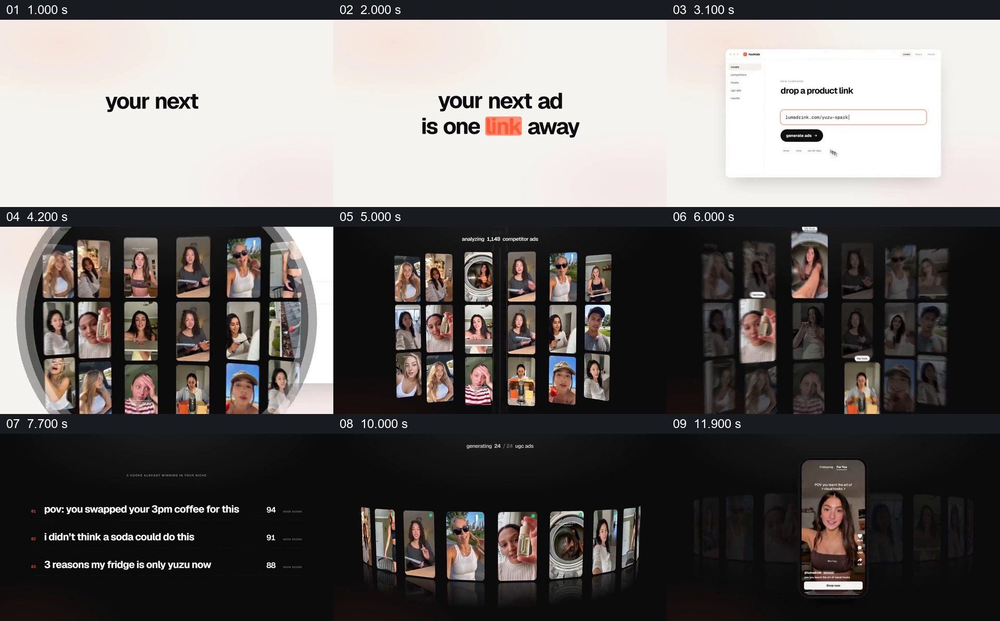

# 从一个链接展开素材墙，再把一组候选收成具体画面

- 作品：案例 003《人物视频墙与手机展示》，为库内索引名称。
- 原片范围：00:00.000–00:12.100；[完整原片](../video.mp4)｜[本卡片段](c01.mp4)。
- 范围依据：从“一个链接”的输入建立开始，经过材料集合、选择与候选生成，到单条手机画面出现；该画面同时是下一张卡的入口。与下一卡重叠 00:11.100–00:12.100，用来保留候选集合到手机的交接。
- 观察方式与未确认范围：查看全片 64 帧总览、本卡九宫格，并对 00:03.4–00:07.2 和 00:10.8–00:14.6 按约 0.2 秒间隔补看源帧；参考自动视频分析并以源帧纠正其中的时间和数字。未独立完成连续原速观看与听审，精确运动曲线、停顿及声音配合待复核。影片中的界面、评分和素材来源均按画面演示描述。

## 原画面具体怎样设计

**把复杂流程压到一个容易辨认的入口。** 浅米色背景上，黑色短句逐步组成“your next ad is one link away”，其中“link”用橙色突出。文字让位于一张居中的浅色网页界面；网址进入输入框，按钮位于其下。界面中的侧栏、标题与输入框共同说明这是一个产品操作画面，观众的焦点从口号移到具体输入。

**从单个界面进入一组素材。** 约 00:03.8–00:04.4，网页界面放大，圆形开口内显露深色背景和多个人物竖屏小窗；随后深色空间占满画面，小窗排成多列多行，上方出现正在分析竞品广告及变化的数量。人物画面在各自窗口内变化，窗口保有竖屏边界；暗底和相近的尺寸把原本分散的片段放进同一个集合。这里可见的是作品对分析过程的表现，不能据此确认素材来源或实际分析数量。

**先从集合中挑出局部，再把焦点交给文字。** 约 00:05.6，部分小窗被提亮并配有小标签，其他窗口压暗；因此视线从整面素材墙转向少数样例。接下来窗口退出，深色背景保留，三行广告开头文案从上到下列出，左侧是橙色编号，右侧是逐步变化的分数。观众的阅读中心由多个人物转为文字及其相对排序；不是所有素材、列表与视频环都同时叠在一起。

**让候选重新成为可观看对象。** 约 00:08 起，文案列表交给弧形排列的竖屏视频卡片，暗色空间、地面倒影和顶部的生成进度共同建立一组候选；进度显示至 24/24，部分卡片角上可见绿色标记。到约 00:11，视频环仍在背景中，一条手机大小的人物视频进入前景，其余卡片变暗、退后；约 00:12，单条手机画面成为主要观看对象。本卡在这里结束，下一段继续使用手机和旁侧面板讲述发布与结果。

## 为什么这样设计，好在哪里

原片把“一个输入”与“许多可见材料”放在相邻阶段，规模上的变化让抽象操作获得画面结果。视频墙先以相似尺寸建立集合，局部提亮后才显示三条文案，解决的是“先看有哪些材料，再看画面想强调哪些结论”的顺序；如果所有窗口始终同样醒目，观众较难知道要先看哪里。

列表退出后，竖屏格式再次用于候选环：观众先看到一组可能结果，随后手机成为前景，其余视频仍短暂留在后方作为集合参照，注意力由“很多”收束到“一个”。如果直接从链接跳到手机，输入与结果仍能并列，但中间的材料规模、筛选重点和候选集合就不再可见。

以上是对可见设计的解释，不证明作者的真实意图或系统能力。原片把分数、处理数量与生成状态作为演示；没有独立依据时，不把这些画面当作真实运行记录，也不断言前后出现的是同一批素材。

## 可直接使用的创意指令

当内容确实需要解释“一个简明输入如何进入多份材料，并产生可选结果”时，准备一个容易辨认的输入对象、一组与其有关且能够展示的素材，以及少量能代表筛选或归纳结果的信息。先让输入独立成立，再把观众带进材料集合：为每份材料保留独立边界与辨认空间，用共同背景或排列建立它们属于一组的关系。

从集合中突出少数真正需要关注的内容，同时让其余材料退到次要层级；再把焦点交给经过核实、数量适合阅读的文字或结论。依据新项目的流程，把结论接到一组实际可展示的候选，并从集合中选出一个清楚的观看对象。保留集合向单个结果交接的必要中途，使观众知道这个对象来自一组候选。

可按材料重设入口、窗口形态、颜色、数量、背景和排列，也可改变集合的空间形状；需要保留输入、素材集合、被强调的重点和可辨认结果之间的关系。若新项目只有一个结果、缺少可展示的中间材料，或需要详细解释算法因果，就应重新设计，不能把装饰性视频墙当作处理证据。实际系统、评分和素材归属应有依据；模拟演示应作相应标识。新题材迁移尚未实测。
