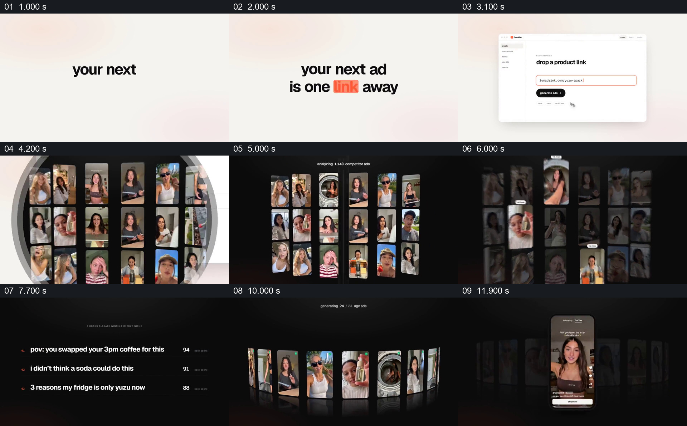

# 从一个链接展开素材墙，再把一组候选收成具体画面

- 作品：案例 003《人物视频墙与手机展示》，为库内索引名称。
- 原片范围：00:00.000–00:12.100；[完整原片](../video.mp4)｜[本卡片段](c01.mp4)。
- 范围依据：从“一个链接”的输入建立开始，经过材料集合、选择与候选生成，到单条手机画面出现；该画面同时是下一张卡的入口。与下一卡重叠 00:11.100–00:12.100，用来保留候选集合到手机的交接。
- 观察方式与未确认范围：查看全片 64 帧总览、本卡九宫格，并对 00:03.4–00:07.2 和 00:10.8–00:14.6 按约 0.2 秒间隔补看源帧；参考自动视频分析并以源帧纠正其中的时间和数字。未独立完成连续原速观看与听审，精确运动曲线、停顿及声音配合待复核。影片中的界面、评分和素材来源均按画面演示描述。

## 原画面具体怎样设计

**把复杂流程压到一个容易辨认的入口。** 浅米色背景上，黑色短句逐步组成“your next ad is one link away”，其中“link”用橙色突出。文字让位于一张居中的浅色网页界面；网址进入输入框，按钮位于其下。界面中的侧栏、标题与输入框共同说明这是一个产品操作画面，观众的焦点从口号移到具体输入。

**从单个界面进入一组素材。** 约 00:03.8–00:04.4，网页界面放大，圆形开口内显露深色背景和多个人物竖屏小窗；随后深色空间占满画面，小窗排成多列多行，上方出现正在分析竞品广告及变化的数量。人物画面在各自窗口内变化，窗口保有竖屏边界；暗底和相近的尺寸把原本分散的片段放进同一个集合。这里可见的是作品对分析过程的表现，不能据此确认素材来源或实际分析数量。

**先从集合中挑出局部，再把焦点交给文字。** 约 00:05.6，部分小窗被提亮并配有小标签，其他窗口压暗；因此视线从整面素材墙转向少数样例。接下来窗口退出，深色背景保留，三行广告开头文案从上到下列出，左侧是橙色编号，右侧是逐步变化的分数。观众的阅读中心由多个人物转为文字及其相对排序；不是所有素材、列表与视频环都同时叠在一起。

**让候选重新成为可观看对象。** 约 00:08 起，文案列表交给弧形排列的竖屏视频卡片，暗色空间、地面倒影和顶部的生成进度共同建立一组候选；进度显示至 24/24，部分卡片角上可见绿色标记。到约 00:11，视频环仍在背景中，一条手机大小的人物视频进入前景，其余卡片变暗、退后；约 00:12，单条手机画面成为主要观看对象。本卡在这里结束，下一段继续使用手机和旁侧面板讲述发布与结果。

## 为什么这样设计，好在哪里

原片把“一个输入”与“许多可见材料”放在相邻阶段，规模上的变化让抽象操作获得画面结果。视频墙先以相似尺寸建立集合，局部提亮后才显示三条文案，解决的是“先看有哪些材料，再看画面想强调哪些结论”的顺序；如果所有窗口始终同样醒目，观众较难知道要先看哪里。

列表退出后，竖屏格式再次用于候选环：观众先看到一组可能结果，随后手机成为前景，其余视频仍短暂留在后方作为集合参照，注意力由“很多”收束到“一个”。如果直接从链接跳到手机，输入与结果仍能并列，但中间的材料规模、筛选重点和候选集合就不再可见。

以上是对可见设计的解释，不证明作者的真实意图或系统能力。原片把分数、处理数量与生成状态作为演示；没有独立依据时，不把这些画面当作真实运行记录，也不断言前后出现的是同一批素材。

## 完整照排指令

以[完整原片](../video.mp4)的 0–12.1 秒为准。画幅 1280×720，源帧率 60/1。以下拍点为抽帧定位，位置按画幅百分比取近似值。

### 用料

- 【首行短句】【次行短句】【强调词】合为两行简短开场词，【强调词】须在次行中有明确位置。另备【输入标题】【输入链接】【输入按钮】及对应可展示操作页面。页面可用去标识的真实截图分层，真实流程留可核对的源地址或录屏。
- 【分析素材组】准备约十八段可辨认的竖屏动态，面部或动作尽量在中部。指定其中三段为【入选素材】，供原窗提亮，并提供【入选标签】。准备【分析进度】、三条【候选文案】及分别对应的【候选得分】。演示读数应明确标示演示。真实分析附原任务记录、统计口径和素材链接。
- 【生成候选组】为同一任务的另一批竖屏成果，约 24 条，备【生成进度】和已完成项的【完成状态】。从组中指定一条【入机候选】，用于最后手机和相邻卡入口。需要带播放进度连续的竖屏片，手机截取同一条源视频的连续段。分析素材与生成成品若非同一条，不做假同源匹配。

### 按源时刻摆放

1. **0.000–约 2.000 秒。** 浅暖白背景保留少量粉灰起伏，黑粗无衬线【首行短句】在中心逐词拼齐。其下近同字号排【次行短句】，句中只将【强调词】用橙红。两行间距紧。接着浅色及橙色矩形擦过字面，带走中心字组。
2. **约 2.333–4.333 秒。** 悬起带软阴影的白网页，约 x18%–82%、y15%–84%，上部细条、左侧窄导航，主体偏左放黑粗【输入标题】。其下窄长框以浅橙描边，输入【输入链接】，下方黑底白小字【输入按钮】。约 3.7 秒整体放大，页面中心由小圆开口露出深底竖屏；圆扩大到边缘出画，画面移交深底素材墙。
3. **约 4.333–6.000 秒。** 近黑背景，约六列三行【分析素材组】围绕中心排，外侧列稍倾并透视收窄。中列为对照基准，保留短窄暗缝；画顶中央一行极小白【分析进度】。从圆孔初露到整墙再到选择处，各窗保持相同片源与播放进度。约 5.667 秒大部分窗压暗，只有分布在不同列及行的【入选素材】提亮并在上沿附小白【入选标签】，暗窗持续显示到列表接管。每窗备约 2 秒连续竖屏；现场动作禁用循环和冻结。只担任气氛的未入选窗口允许无跳点循环，尤其不能在提亮前后重起。
4. **约 6.000–8.000 秒。** 深底保持，视频墙全退。行列从上向下显出，橙色小索引在左，白色【候选文案】各占一行，右端对齐【候选得分】，细弱分隔线收住。先立首行、再加后二行，过程分数变化后稳定。完成即清掉整张列表，留黑空间。
5. **约 8.000–11.667 秒。** 小号居中的【生成进度】在椭圆候选带上方，竖卡排列在环近侧，中心卡略大，边卡绕向后景。镜面地面只留短暗倒影。多个【生成候选组】画面在卡内播放，部分角标出现【完成状态】，进度最后与实际候选数相符。约 10–10.667 秒横摆提速，卡边短暂拉成重影，再恢复清楚。展示中的候选自初次显露到移交继续播放。边缘背景卡允许平稳循环，前景将采用的【入机候选】备从环内被认出至下卡面板结束的连续段。
6. **约 11.667–12.100 秒。** 【入机候选】进到中轴手机壳，带细社交界面并保持竖裁，背景环先压暗并留一拍，随后手机向左移动给右侧腾位。手机已经读成独立观看对象时在 12.100 秒接出。沿相邻卡连续使用时，共用这一秒重叠源段一次。

### 局部采用

只有输入与足够分析片时，可用 0.000–约 6.000 秒，在入选点亮后切出。只具备生成候选时，可从约 8.000 秒暗场开始，到 12.100 秒手机交接。只有一条视频时，无法承担成环和选出一条之间的关系。

### 验证状态

已查看原片 3 帧/秒时间序列并读回卡稿。重点对照约 4 秒从白页圆孔先露竖窗、5.667 秒亮窗保留暗墙参照、6 秒后列表独占、11.667 秒手机抢前景而后墙仍在。更细过渡帧、原速听看和换料试摆待核。
