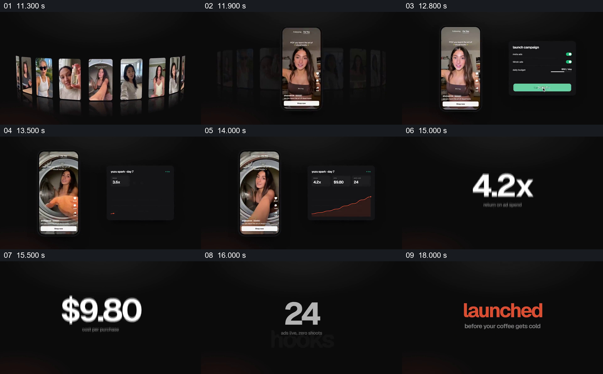

# 让候选进入手机，以同一观看场景连接投放与结果

- 作品：案例 003《人物视频墙与手机展示》，为库内索引名称。
- 原片范围：00:11.100–00:18.400；[完整原片](../video.mp4)｜[本卡片段](c02.mp4)。片段内部 00:00 对应原片 00:11.100；下方分镜标的是原片时间。
- 范围依据：保留候选视频环作为手机出现的前因，随后展示设置、结果及放大指标，至“launched”文字收束；之后主要是品牌标识，没有另建创意卡。与前卡重叠 1 秒，用于共同交接。
- 观察方式与未确认范围：查看全片 64 帧总览、本卡九宫格，另以约 0.2 秒间隔核对原片 00:10.8–00:14.6，并参考自动视频分析。未独立完成连续原速观看和听审；关键动作的精确速度、声音落点与后续迁移效果待核。片中结果是画面演示，未经独立核实。

## 原画面具体怎样设计

**以已有候选作入口。** 原片 00:11.100 附近，多个竖屏人物画面在深色空间排成弧形，地面有反射。到约 00:11.8，一条带社交视频界面的手机画面出现在中间前景，后面的候选小窗仍然可见但已压暗；随后手机偏向左侧，右边腾出位置。观众从看一组候选，转向看一个实际观看载体中的人物内容。

**手机作为参照，旁边切换解释内容。** 约 00:12.2，右侧出现深色“launch campaign”面板，包含 Meta、TikTok 开关、每日预算和发布按钮；画面中开关与数值逐步改变，按钮变绿并显示 24 条广告上线。手机留在左侧，继续承载人物视频。约 00:13.2 起，手机内人物画面改变；右侧发布设置退出，由标着第七天的结果面板接替，面板里的数字与曲线逐渐显现。手机与结果并置，使观众仍有具体内容可看，同时将注意力移到右侧结果。

**从面板总览转为单项结果。** 约 00:14，手机旁的面板可见 4.2x、$9.80、24 和上升曲线；接着手机与面板让位于黑底，4.2x、$9.80、24 及短词先后被置于画面中央，较小文字说明指标或状态。最后出现橙色“launched”，下方接“before your coffee gets cold”；18.4 秒以后原片转入品牌标识。本卡把逐项强调与结尾短句作为结果的完成状态。

## 为什么这样设计，好在哪里

手机把“候选”变成一个观众熟悉的观看场景：先看到实际竖屏内容，再看到旁边如何设置发布。接着左侧手机作为持续参照，右侧由设置换成结果，观众可以沿同一画面位置理解片中声称的前后步骤；如果设置与结果各占一个毫无关联的全屏页面，手机内容与指标的对应关系就需要额外重新建立。

结果面板同时容纳曲线和多个数据，适合先建立整体；后续抽出单项大字，则把阅读焦点从复杂面板移到一个数值。它们先并置、再逐项突出，分别承担“结果属于这条发布内容”和“看清有哪些关键结果”的作用。这里的 4.2x、$9.80 和 24 是源帧中最终可见的演示数字，不等于已核实的广告成效；视频也没有证明旁侧数据与手机内容在真实系统中存在对应关系。

## 可直接使用的创意指令

当需要说明具体内容从候选进入发布或投放，并有对应的设置与可核实结果时，先展示可辨认的候选集合，再让其中一个内容进入与实际观看场景相近的载体。让该载体保留在画面中，把必要设置放在旁侧；完成发布状态的交代后，保持观众能够追踪的内容参照，再由设置区切换到对应结果，避免让设置、内容和结果同时争夺同一层级。

先给出能够说明对象、周期和单位的结果全貌，再按信息量选择少数真正重要的指标单独突出；结束时用准确的结论或下一步承接。设备形态、布局、指标数量、背景和过渡方式都可以重设，但要保留“集合中出现具体内容—内容与设置并置—结果接续同一对象—重点被读清”的关系。

如果没有可信的发布记录或结果数据，可明确将界面作为设想或演示，不把模拟数字呈现为实际成效；如果观众必须仔细比较多个指标，就应延长阅读或保留完整面板，不照搬原片的密集切换。新题材迁移尚未实测。
