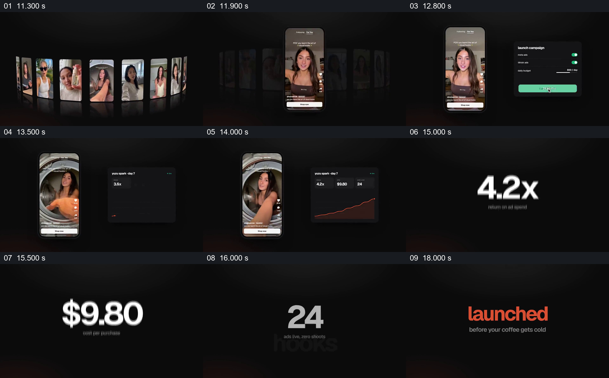

# 让候选进入手机，以同一观看场景连接投放与结果

- 作品：案例 003《人物视频墙与手机展示》，为库内索引名称。
- 原片范围：00:11.100–00:18.400；[完整原片](../video.mp4)｜[本卡片段](c02.mp4)。片段内部 00:00 对应原片 00:11.100；下方分镜标的是原片时间。
- 范围依据：保留候选视频环作为手机出现的前因，随后展示设置、结果及放大指标，至“launched”文字收束；之后主要是品牌标识，没有另建创意卡。与前卡重叠 1 秒，用于共同交接。
- 观察方式与未确认范围：查看全片 64 帧总览、本卡九宫格，另以约 0.2 秒间隔核对原片 00:10.8–00:14.6，并参考自动视频分析。未独立完成连续原速观看和听审；关键动作的精确速度、声音落点与后续迁移效果待核。片中结果是画面演示，未经独立核实。

## 原画面具体怎样设计

**以已有候选作入口。** 原片 00:11.100 附近，多个竖屏人物画面在深色空间排成弧形，地面有反射。到约 00:11.8，一条带社交视频界面的手机画面出现在中间前景，后面的候选小窗仍然可见但已压暗；随后手机偏向左侧，右边腾出位置。观众从看一组候选，转向看一个实际观看载体中的人物内容。

**手机作为参照，旁边切换解释内容。** 约 00:12.2，右侧出现深色“launch campaign”面板，包含 Meta、TikTok 开关、每日预算和发布按钮；画面中开关与数值逐步改变，按钮变绿并显示 24 条广告上线。手机留在左侧，继续承载人物视频。约 00:13.2 起，手机内人物画面改变；右侧发布设置退出，由标着第七天的结果面板接替，面板里的数字与曲线逐渐显现。手机与结果并置，使观众仍有具体内容可看，同时将注意力移到右侧结果。

**从面板总览转为单项结果。** 约 00:14，手机旁的面板可见 4.2x、$9.80、24 和上升曲线；接着手机与面板让位于黑底，4.2x、$9.80、24 及短词先后被置于画面中央，较小文字说明指标或状态。最后出现橙色“launched”，下方接“before your coffee gets cold”；18.4 秒以后原片转入品牌标识。本卡把逐项强调与结尾短句作为结果的完成状态。

## 为什么这样设计，好在哪里

手机把“候选”变成一个观众熟悉的观看场景：先看到实际竖屏内容，再看到旁边如何设置发布。接着左侧手机作为持续参照，右侧由设置换成结果，观众可以沿同一画面位置理解片中声称的前后步骤；如果设置与结果各占一个毫无关联的全屏页面，手机内容与指标的对应关系就需要额外重新建立。

结果面板同时容纳曲线和多个数据，适合先建立整体；后续抽出单项大字，则把阅读焦点从复杂面板移到一个数值。它们先并置、再逐项突出，分别承担“结果属于这条发布内容”和“看清有哪些关键结果”的作用。这里的 4.2x、$9.80 和 24 是源帧中最终可见的演示数字，不等于已核实的广告成效；视频也没有证明旁侧数据与手机内容在真实系统中存在对应关系。

## 完整照排指令

以[完整原片](../video.mp4)的 11.1–18.4 秒为准。画幅 1280×720，源帧率 60/1。以下拍点为抽帧定位，位置按画幅百分比取近似值。

### 用料

- 【生成候选组】【入机候选】沿用前一卡同名填料。入机片须是候选组内可认出的同一条，备用连续竖屏裁切，必要时分清【第二手机素材】是同条后续镜头还是同一批次的另一条。
- 【设置标题】【渠道开关文字】【预算标识】【预算数】【发布按钮】【上线状态】取相同发布任务的设置及状态，使用去标识的页面局部或按真实记录重排。备【结果周期】【指标一】【指标二】【指标三】和各自的【指标说明一】【指标说明二】【指标说明三】、可对上的【结果曲线】。附可打开的结果报表或可追溯导出、任务号、日期、分母和归因口径。真实数值在侧板和随后单屏共用同一数，不把动画中途值当成结果。
- 【过程短词甲】【过程短词乙】【收束词】【收束副句】准备极短字组。收束词描述实际状态；时间承诺须有可核对的依据，演示版可改为精确的操作结束语。

### 按源时刻摆放

1. **11.100–约 12.100 秒。** 从近黑背景的竖屏【生成候选组】环开始。地面反射保持短暗，中心【入机候选】清楚。约 11.8 秒手机到前景中轴，银灰细外框内有社交视频的上下、右侧界面。环卡压暗仍在其后，然后退出。手机移到 x19%–41%、y13%–86%，主体不暂停。若接前一卡，直接承接其手机时钟，不重复播放选片动作。
2. **约 12.100–13.400 秒。** 手机继续播【入机候选】，其右 x54%–89%、y26%–69% 进暗灰圆角设置板。板内靠左一行稍重白色【设置标题】，下方由上到下放两行【渠道开关文字】、再放【预算标识】与右齐的【预算数】。开关从灰翻到绿，底部白底细黑字【发布按钮】变绿色状态条并换【上线状态】。手机壳始终同一处。约 13.2 秒附近竖窗内部切【第二手机素材】，外壳和四周界面保持原位。
3. **约 13.400–14.100 秒。** 设置板整板让位，右边原有范围接同样暗的结果板。上缘小号白字【结果周期】，依次排【指标一】【指标二】【指标三】，其下让橙色折线和暗橙淡填【结果曲线】逐步铺满。手机继续播放到约 14.100 秒，并与结果板同时出镜。人物或物体动态不能用定格、循环或照片运镜补齐；若素材只有一段，须至少从手机放大到结果板退出持续覆盖，并与演示结果属于同一发布任务或明确示意。
4. **约 14.100–16.100 秒。** 黑底接管，手机和旁板一起退。中央粗白超大数按顺序单独出现【指标一】【指标二】【指标三】，下面一行较弱小字为各自的【指标说明一】【指标说明二】【指标说明三】。短重影沿纵向带过表示换读数；一项退尽再进入下一项。原片稳态示例依次为 4.2x、9.80 美元、24，卡稿换料保持单位紧贴相应数字。
5. **约 16.100–18.400 秒。** 相同中轴先出现粗白【过程短词甲】，略上移并退灰时，在它下方接【过程短词乙】，稳态保留单词。随后换橙红粗体【收束词】，小号浅灰【收束副句】在下方落稳。近 18.400 秒切出，后续品牌段另行处理。

### 局部采用

没有候选组但有真实发布及结果，可从约 12.100 秒手机和设置成立处开始。只有同口径的结果指标时，可拿约 14.100–18.400 秒的单项放大拍，前置交代报告对象和周期。只有设置且结果未出时，约 12.100–13.400 秒可单独表达发布状态。

### 验证状态

已查看原片 3 帧/秒时间序列并读回卡稿。重点对照手机出现后候选环退暗、设置绿条与手机同屏、结果数逐个填入侧板后再独立放大。更细过渡帧、原速听看和换料试摆待核。
