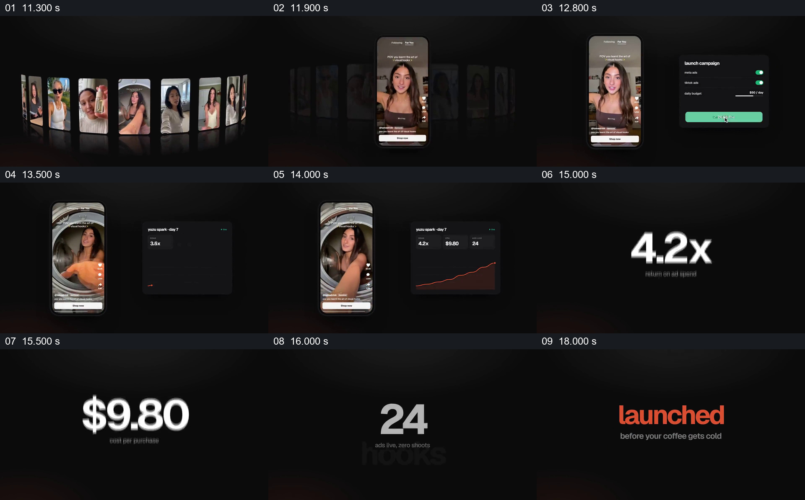

# 从候选广告聚到手机投放，再突出结果指标

- 作品：案例 003《人物视频墙与手机展示》（索引名称）。
- 原片范围：00:11.100–00:18.400，含起点、不含终点；[完整原片](../video.mp4)｜[本卡完整片段](c02.mp4)。与前卡重叠的部分用于保留候选进入手机的共同交接。
- 观察方式：按原片 64 宫格和约每秒一次的原片抽帧观察整片，另核看下方九个原片源帧；未连续原速观看或听审，声音内容与语气未确认。

## 原画面具体怎样设计

暗色背景中的竖屏视频环转动，一条人物视频向前并进入手机框，其他候选退到后方。手机旁出现“launch campaign”面板，列出 Meta、TikTok 和每日预算，按钮变绿并显示 24 条广告上线。手机保留在左侧，右侧面板改成第七天的统计：可见上升曲线、4.2 倍广告支出回报、9.80 美元单次购买成本及 24 条上线广告。

随后手机和面板退出，4.2x、$9.80、24 及 hooks、ads 等文字在暗底上依次放大，最后以橙色“launched”和较小的“before your coffee gets cold”收束，接入品牌标识。

## 为什么这样设计，好在哪里

从候选群中先推出一条具体视频，再把设置和结果放在同一手机旁，观众可以把展示中的内容与片中所说的投放过程联系起来。后段将密集面板中的几个数值单独放大，给每项指标独立的阅读重点，最后的短句又把结果接回开头的快速制作主张。

这些数字、曲线和按钮均是原片中的演示内容；没有独立数据或实际系统记录，不能把它们当作已验证的投放效果。这是作品分析，不代表作者自述或已测得的观众反应。

## 可直接使用的创意指令

当需要展示一条内容从候选进入发布或投放，并且发布状态与结果数据有可靠来源时，先从候选集合中突出一个能辨认的内容，让它进入与实际观看环境相近的载体；在旁边呈现必要的发布设置，再以同一内容为参照交接到对应的结果面板。选择少量对任务真正有意义的指标，保留单位、统计周期和对象，再逐项放大以便阅读，结尾接到准确的下一步或结论。设备样式、指标数量和布局按新材料调整；若结果只是预期或界面演示，应明确标注，不把模拟曲线、按钮或数字当成已发生的效果。
