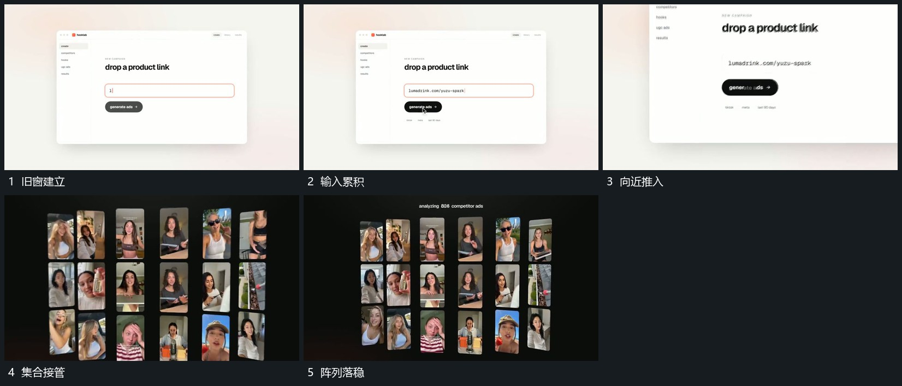

# 窗口推近退出，图块集合接管

## 运动指令

保持窗口边界，先在内部逐字输入。输入完成后窗口向近处放大、边缘越出，新竖片集合接管画面，排成多行多列并保留。

## 视频切片

[播放本机制的原片切片](m02.mp4)

覆盖分镜中“旧窗建立”至“阵列落稳”的连续过程，并保留邻近的前后衔接画面；原片中交叠发生的动作一并保留。

## 分镜过程

## 组合与调整

保留推近的去向与新集合的建立；这是换场接续，不认定旧窗每个部件都变成集合中的片。
