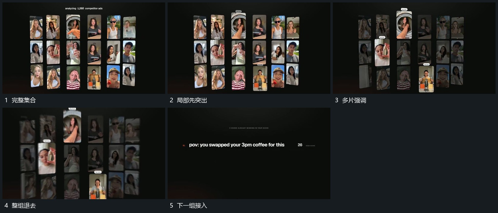

# 集合中少量片突出，其余退淡后共同离场

## 运动指令

从已存在阵列里突出少量竖片，使它们更清楚并略向前，其余片退淡。突出片保持可辨认后，整组加快退去，下一文字组接入让出的中部。

## 视频切片

[播放本机制的原片切片](m03.mp4)

覆盖分镜中“完整集合”至“下一组接入”的连续过程，并保留邻近的前后衔接画面；原片中交叠发生的动作一并保留。

## 分镜过程

## 组合与调整

可调选中数量，保留来源位置；下一组要等阵列让出主要区域后建立。
