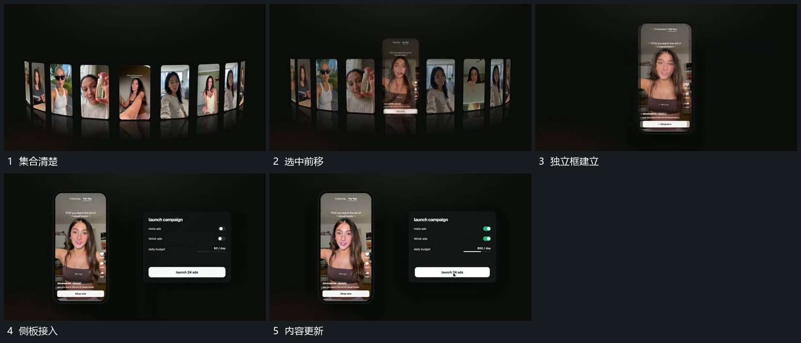

# 选中竖片向前接管，旁侧面板补入

## 运动指令

从停清的集合中提起一片向前，周围片减淡退出。留下独立竖框后，在旁侧补入面板，框内继续变化，面板内标记和条形依次更新。

## 视频切片

[播放本机制的原片切片](m05.mp4)

覆盖分镜中“集合清楚”至“内容更新”的连续过程，并保留邻近的前后衔接画面；原片中交叠发生的动作一并保留。

## 分镜过程

## 组合与调整

可换选中项，必须从原位置接起；侧板不能在选中片还被后层遮住时抢占重点。
