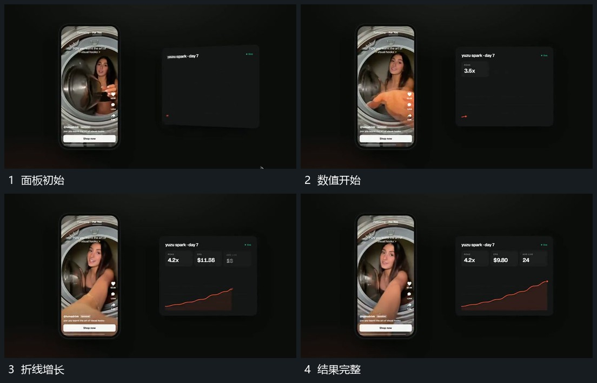

# 数字与折线在固定面板内逐步增长

## 运动指令

保持两侧外框，让旁侧数值逐步更换，折线从左端向右延长，已走过的线保留，下方填充跟进。达到最终状态后数值与路径停稳，框内活动仍继续。

## 视频切片

[播放本机制的原片切片](m06.mp4)

覆盖分镜中“面板初始”至“结果完整”的连续过程，并保留邻近的前后衔接画面；原片中交叠发生的动作一并保留。

## 分镜过程

## 组合与调整

路径与数值含义需在新片另定；保持固定参照，不把整面板反复重画。
