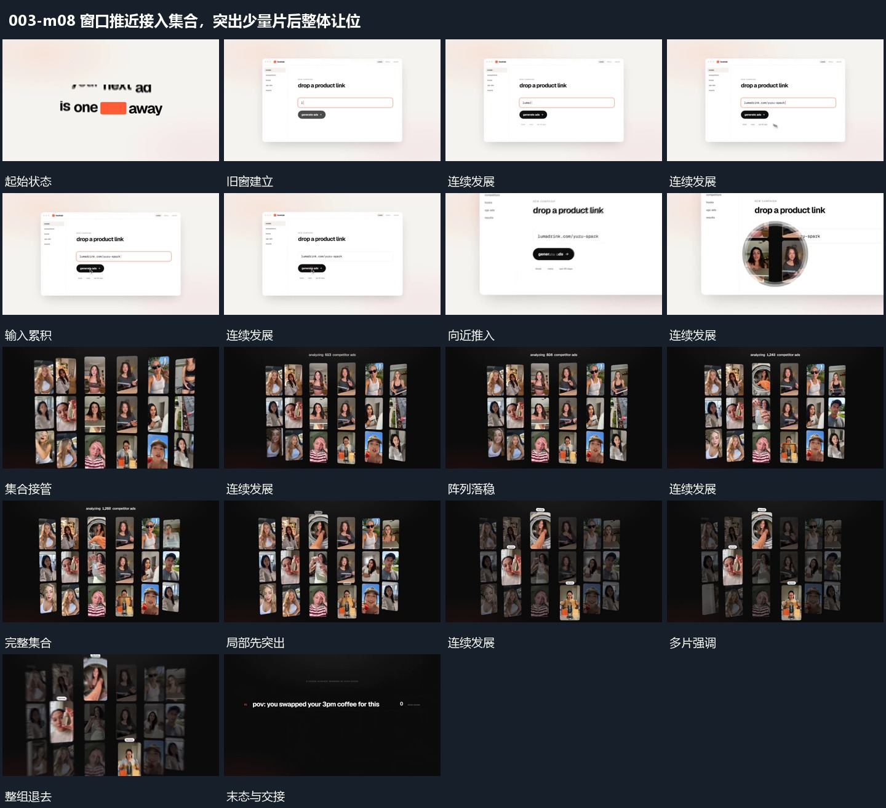

# 窗口推近接入集合，突出少量片后整体让位

## 运动指令

先由旧窗推近接入网格，再在同一网格中突出少量片；其余退淡，整组共同让位。

1. **窗口推近退出，图块集合接管**

保持窗口边界，先在内部逐字输入。输入完成后窗口向近处放大、边缘越出，新竖片集合接管画面，排成多行多列并保留。

2. **集合中少量片突出，其余退淡后共同离场**

从已存在阵列里突出少量竖片，使它们更清楚并略向前，其余片退淡。突出片保持可辨认后，整组加快退去，下一文字组接入让出的中部。

整段结束：突出片与旧集合退出，空位交给下一组 保留必要落稳与交接，中间已建立的参照沿用到下一步骤。

## 视频切片

[播放本机制的原片切片](m08.mp4)

保留起始准备、连续发展和完成或明确交接；首尾按本段运动范围裁切，不拼接、不变速。相连的小动作合为同一完整段落。

## 分镜过程

## 组合与调整

先由旧窗推近接入网格，再在同一网格中突出少量片；其余退淡，整组共同让位。 复用时可调整元素数量、幅度和相对节奏，保留上述进入、交叠与完成关系；不直接沿用原片题材或时长。

保留推近的去向与新集合的建立；这是换场接续，不认定旧窗每个部件都变成集合中的片。

可调选中数量，保留来源位置；下一组要等阵列让出主要区域后建立。
