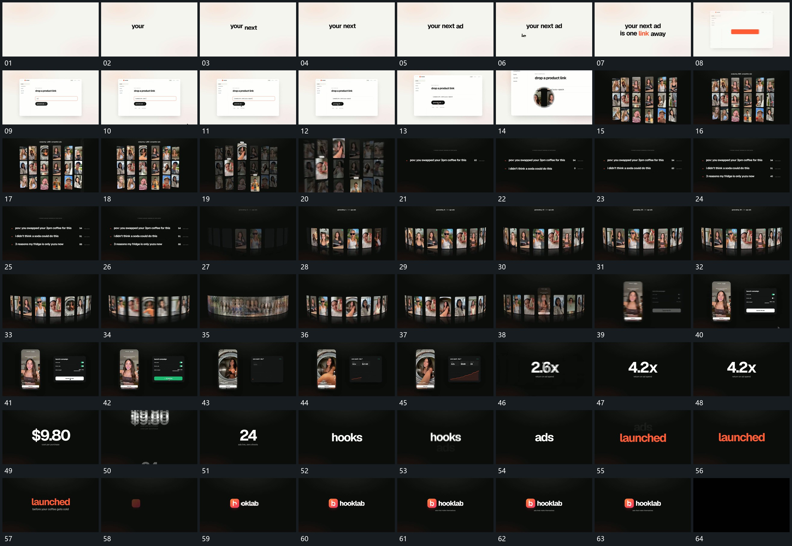

# 003｜原片运动总览

[观看完整原片](video.mp4)

## 运动总览

开头 文字逐词补入，完成后保持整组 逐词建立两行字组，随后固定窗口与输入行接入。窗口推近退出，图块集合接管 从输入状态推向图块集合，集合先留场，再 集合中少量片突出，其余退淡后共同离场 突出少量前景片并退去整组。

中间按行建立短句与数字，复用 文字逐词补入，完成后保持整组 的逐项累积。接着 弧形竖片逐项补齐，加速横移后停清 沿弧形排列补齐竖片，加快横向轮换后停清；选中竖片向前接管，旁侧面板补入 从集合中提起一片，周边退淡，新旁侧面板接入。框内持续变化时，数字与折线在固定面板内逐步增长 让旁侧计数与折线逐步增长。最后 大字沿竖向轮换，末组收成短行 在同一位置轮换大字，再建立小标记、短行和附属字收尾。

## 完整运动段落

以下按原片中的出现顺序引用。建立、内部发展及完成反馈放在同一段中；同时发生的局部动作与运镜写在同一份指令里。不同段之间可以是连续接管，也可以是直接切换，不能仅凭条目相邻认定可直接拼接。重复出现的同类运动采用一次连续代表范围，切片不以逐段无缝覆盖整片为目标。

1. [文字逐词补入，完成后保持整组](mechanisms/m01.md)：已出现的词保持，后一词在其后补入

2. [窗口推近接入集合，突出少量片后整体让位](mechanisms/m08.md)：先由旧窗推近接入网格，再在同一网格中突出少量片；其余退淡，整组共同让位。

3. [弧形集合滚动选出一片，旁板接入并更新结果](mechanisms/m09.md)：弧形集合先补齐并滚动，选中片前移成为稳定参照，旁侧面板接入并以数字和折线完成反馈。

4. [大字沿竖向轮换，末组收成短行](mechanisms/m07.md)：旧字上退新字接上，尾部再转入固定短行

切片保留起始准备、必要内部停顿和完成或明确交接；首尾省略无新发展的等待，持续运动不要求人为停住。以上基于真实源帧序列和重点边界核对，不等同于全片连续声画审片。

## 完整64宫格

