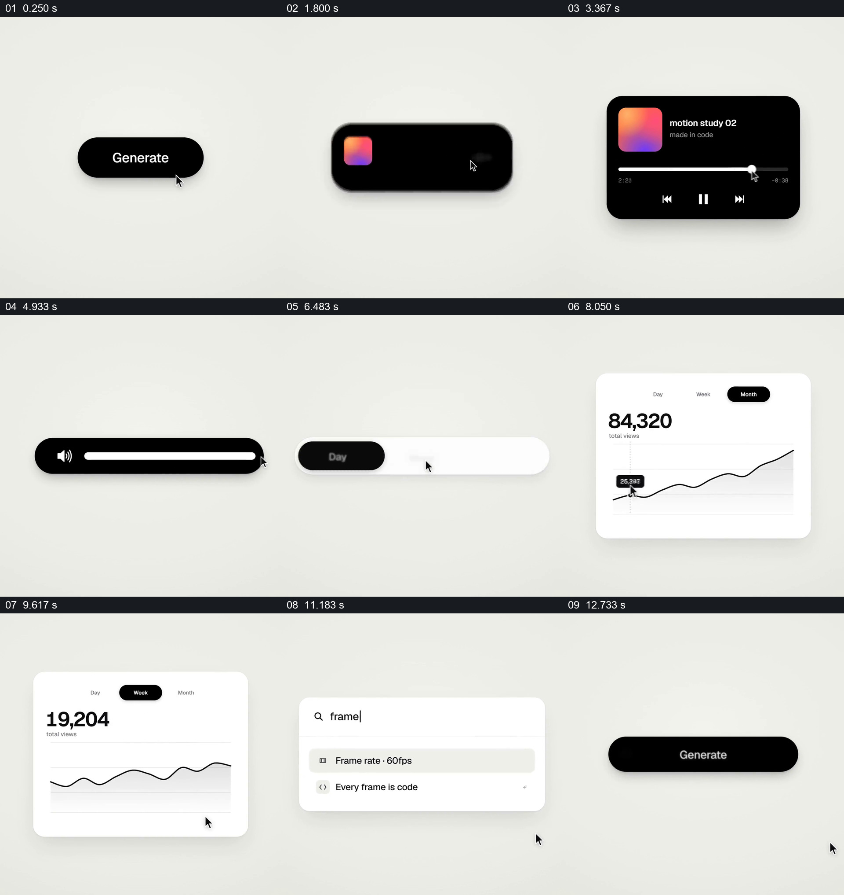

# 在同一浅色舞台中，让胶囊按钮接力展示播放器、图表和搜索

- 作品：案例 109《纯控件的连续状态变化》（库内索引名称）。
- 原片范围：00:00.000–00:14.058，含起点、不含终点；[完整原片](../video.mp4)｜[本卡片段](../video.mp4)。
- 范围依据：从 Generate 按钮、加载和完成，到不同控件状态、图表与搜索，再回到按钮；整片保留。
- 观察方式与未确认范围：查看整片 64 帧总览和本卡分镜。未独立完成连续原速观看与听审；抽帧之间的运动、停顿与声音配合待复核。画面中的界面、数字与说明是作品呈现，未经额外核实；设计价值为基于画面的分析。

## 原画面具体怎样设计

浅灰白背景中央，一个黑色圆角 Generate 按钮旁有鼠标指针；后续抽帧依次显示圆形加载标记、对勾，再出现带彩色封面的黑色横条和更大的音乐播放器卡片，卡片包含播放键与进度条。

画面随后依次展示黑色音量滑杆、白黑开关、Day/Week/Month 分段选项；与时间选项关联的白色图表卡中有总数、折线和光标提示，不同抽帧显示月与周的数值和曲线。最后出现白色命令搜索卡，输入 frame 后列表剩下相关命令；一个黑色确认条出现，随后画面回到 Generate 按钮。

所有控件都位于近似画面中心，以黑白圆角、阴影和指针保持一致；抽帧能确认各状态顺序，不能证明它们之间每次都是连续形变，也不能验证真实交互。

## 为什么这样设计，好在哪里

把控件置于同一空白舞台，减少背景变化对注意力的干扰；黑色胶囊与白色圆角卡反复出现，使播放器、开关和搜索虽属不同功能，仍像同一组设计语言。每个组件至少展示一个有意义的状态变化，如按钮从等待到完成、时间范围改变后图表跟随，最终回到初始按钮形成收束。

片中数字与图表是示意，未经核实；鼠标指针不代表本次已实际操作界面。

## 可直接使用的创意指令

选择一组有真实状态变化的控件，让它们在统一背景与稳定视区内依次出现；每个组件展示明确输入及对应反馈，例如选择、加载、完成、数值变化或搜索结果。保持一致的尺寸逻辑、圆角、对比度和指针位置，再将最后状态收回到开头的入口。

控件形态和颜色可改变，不必强求所有元素连续变形；需要证明交互时应录制实际操作，示例数据和状态需明确标注。

本方法尚未在新题材中实测。
