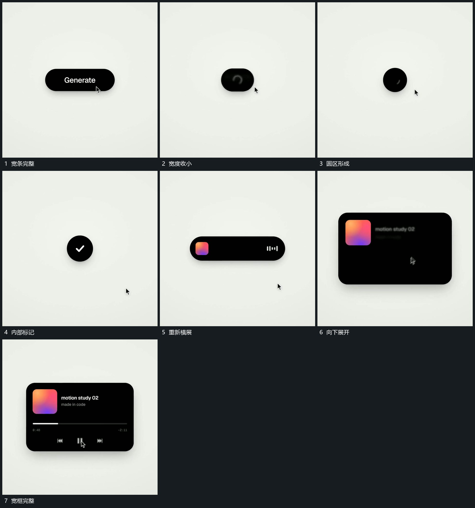

# 宽条收成圆区再伸展并向下打开宽框

## 运动指令

让宽条两端向中心收近，内部短行先退去，直到外边界形成小圆区。圆区内部短线转向后建立小标，再把两侧边界拉开成短条，向下增加高度成为宽框，内部片面与字行随后接入。

## 视频切片

[播放本机制的原片切片](m01.mp4)

覆盖分镜中“宽条完整”至“宽框完整”的连续过程，并保留邻近的前后衔接画面；原片中交叠发生的动作一并保留。

## 分镜过程

## 组合与调整

形变共享同一中心；内部层在边界变化中退让和接入，不把每个状态当独立框闪现。
