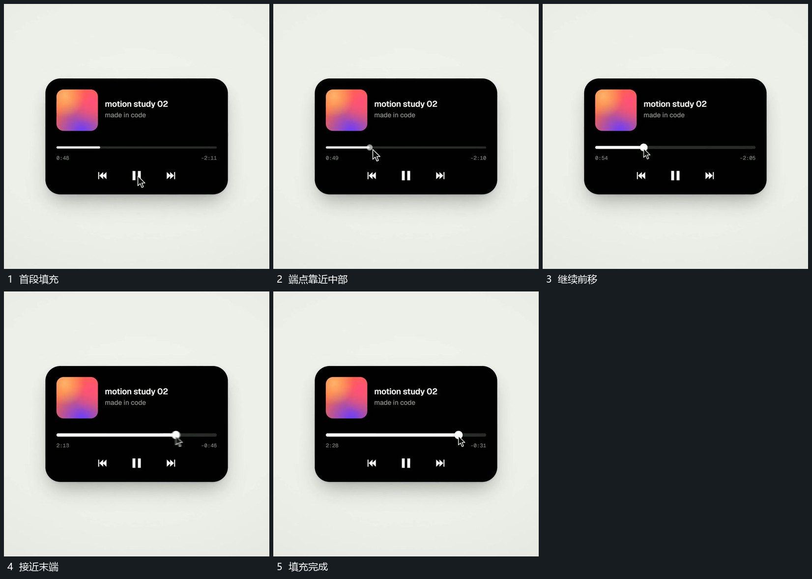

# 长线端点沿线移动经过范围留下填充

## 运动指令

保留长线范围，让小端点沿线移动，经过部分留下连续填充，未经过部分保持较弱。旁侧小行在原位接替，外框不改变尺寸；端点到末端后填充保持，不继续越出边界。

## 视频切片

[播放本机制的原片切片](m02.mp4)

覆盖分镜中“首段填充”至“填充完成”的连续过程，并保留邻近的前后衔接画面；原片中交叠发生的动作一并保留。

## 分镜过程

## 组合与调整

可用于任意进度关系，填充严格跟随端点，不需原界面内容。
