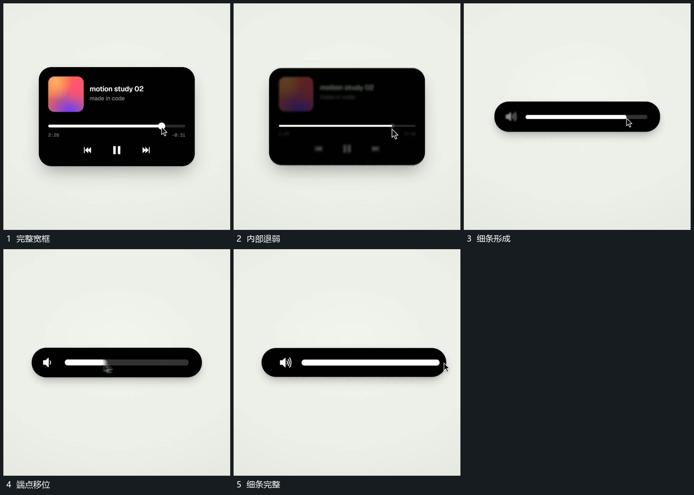

# 宽框压低收成细条原长线仍保留

## 运动指令

先减弱宽框中的图块、字行和下方小形，保留中部运动线。外框上边向下、下边向上收近，高度压低形成细条；线与端点在收缩中仍连续，收成细条后继续沿线移动。

## 视频切片

[播放本机制的原片切片](m03.mp4)

覆盖分镜中“完整宽框”至“细条完整”的连续过程，并保留邻近的前后衔接画面；原片中交叠发生的动作一并保留。

## 分镜过程

## 组合与调整

保留层先明确；不能让整框全退净再重新弹出另一条线。
