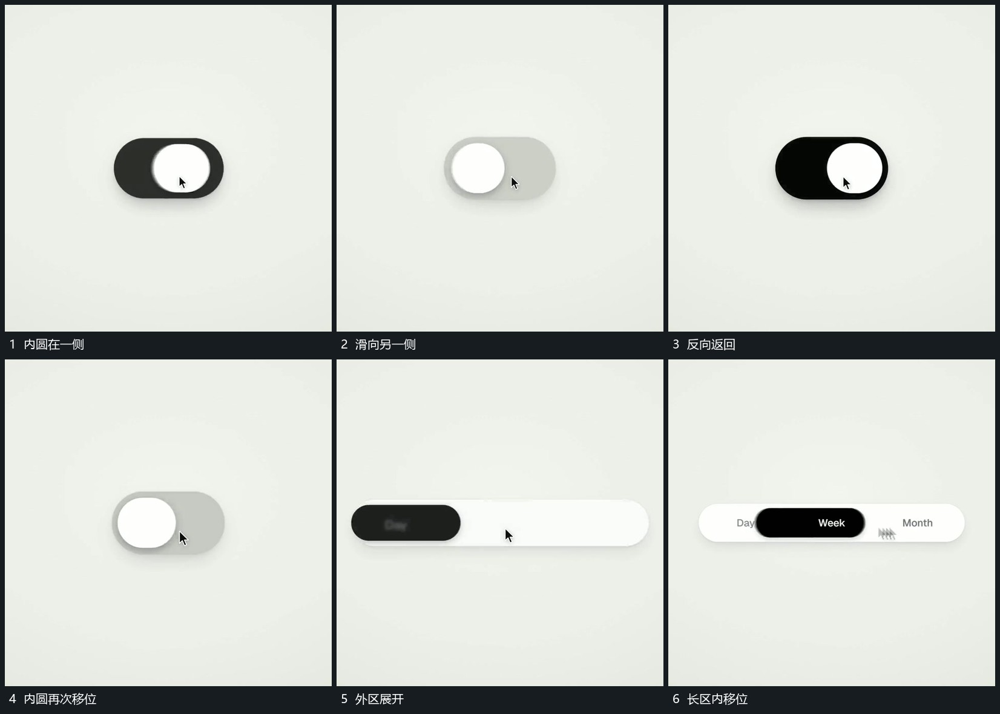

# 短区内圆左右滑动再把外区横向展开

## 运动指令

短外区保持，内圆从一侧滑向另一侧，接近端部时减小位移，再反向返回。之后外区向横向展开，原内圆拉长为小片并沿多个位置移动；其他位置短行依次建立。

## 视频切片

[播放本机制的原片切片](m04.mp4)

覆盖分镜中“内圆在一侧”至“长区内移位”的连续过程，并保留邻近的前后衔接画面；原片中交叠发生的动作一并保留。

## 分镜过程

## 组合与调整

位置数量按需要变化；滑动沿同一内部范围，不让内圆跨越外边界。
