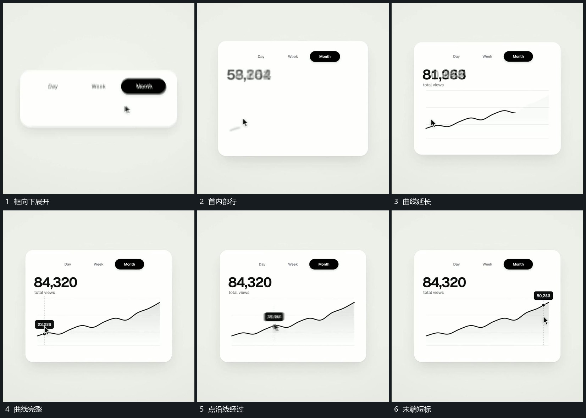

# 框内曲线逐段描出小点沿线经过并带动短标

## 运动指令

框向下展开后先补内部主行，再从曲线一端逐段描到另一端。曲线完成后小点沿线移动，垂向短标随点位置更新，旁侧数值在同一标签范围接替；框与主行保持。

## 视频切片

[播放本机制的原片切片](m05.mp4)

覆盖分镜中“框向下展开”至“末端短标”的连续过程，并保留邻近的前后衔接画面；原片中交叠发生的动作一并保留。

## 分镜过程

## 组合与调整

路径先建立再移动小点；短标仅跟随所在局部，不带动整框。
