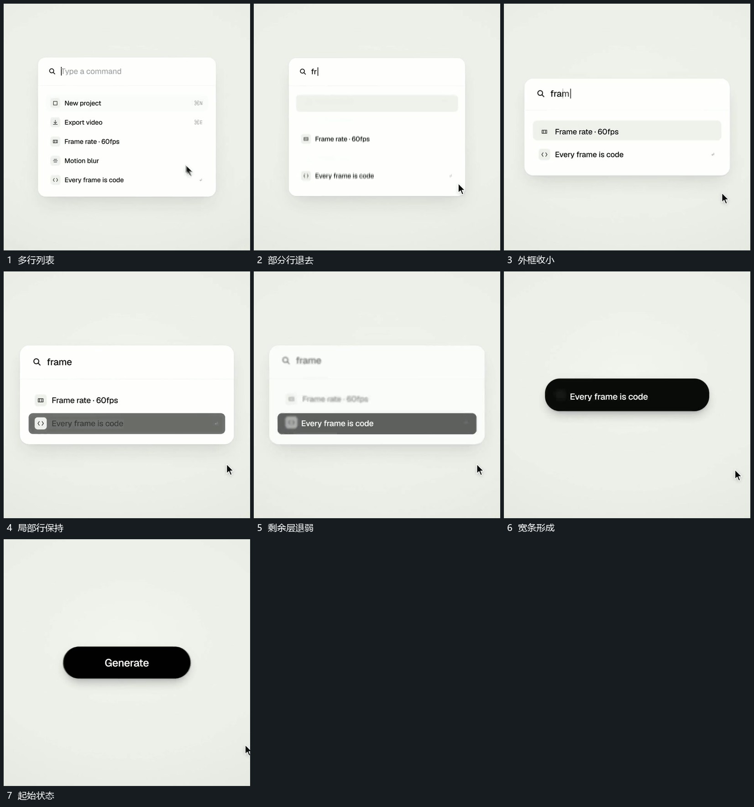

# 列表逐项减少外框随内容收小最后回成短条

## 运动指令

保留上方短行，列表项逐项退去，后项沿原列向上补位，外框高度随剩余内容收小。选中的最后一项暂时保留，再减弱附属层，外框继续压低成为宽条，短行最后在条内接替。

## 视频切片

[播放本机制的原片切片](m06.mp4)

覆盖分镜中“多行列表”至“起始状态”的连续过程，并保留邻近的前后衔接画面；原片中交叠发生的动作一并保留。

## 分镜过程

## 组合与调整

先减项再收边界，避免框缩小时切断仍需保留的行；回收后可接新的条内运动。
