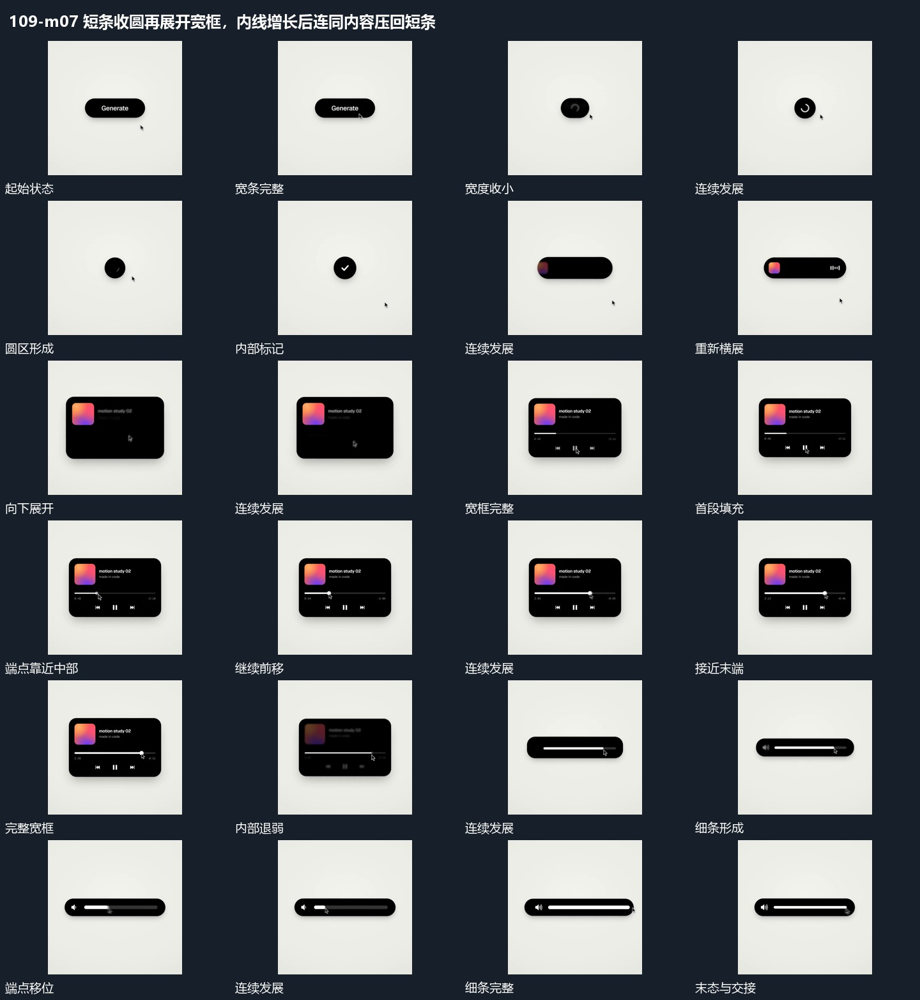

# 短条收圆再展开宽框，内线增长后连同内容压回短条

## 运动指令

短条收缩为圆区并完成局部反馈，圆区展开成长条再向下打开宽框；框内长线沿轴增长，内容随后退弱，宽框压低收回为短条而细线仍保留。

1. **宽条收成圆区再伸展并向下打开宽框**

让宽条两端向中心收近，内部短行先退去，直到外边界形成小圆区。圆区内部短线转向后建立小标，再把两侧边界拉开成短条，向下增加高度成为宽框，内部片面与字行随后接入。

2. **长线端点沿线移动经过范围留下填充**

保留长线范围，让小端点沿线移动，经过部分留下连续填充，未经过部分保持较弱。旁侧小行在原位接替，外框不改变尺寸；端点到末端后填充保持，不继续越出边界。

3. **宽框压低收成细条原长线仍保留**

先减弱宽框中的图块、字行和下方小形，保留中部运动线。外框上边向下、下边向上收近，高度压低形成细条；线与端点在收缩中仍连续，收成细条后继续沿线移动。

整段结束：细条仅留长线与端点 保留必要落稳与交接，中间已建立的参照沿用到下一步骤。

## 视频切片

[播放本机制的原片切片](m07.mp4)

保留起始准备、连续发展和完成或明确交接；首尾按本段运动范围裁切，不拼接、不变速。相连的小动作合为同一完整段落。

## 分镜过程

## 组合与调整

短条收缩为圆区并完成局部反馈，圆区展开成长条再向下打开宽框；框内长线沿轴增长，内容随后退弱，宽框压低收回为短条而细线仍保留。 复用时可调整元素数量、幅度和相对节奏，保留上述进入、交叠与完成关系；不直接沿用原片题材或时长。

形变共享同一中心；内部层在边界变化中退让和接入，不把每个状态当独立框闪现。

可用于任意进度关系，填充严格跟随端点，不需原界面内容。

保留层先明确；不能让整框全退净再重新弹出另一条线。
