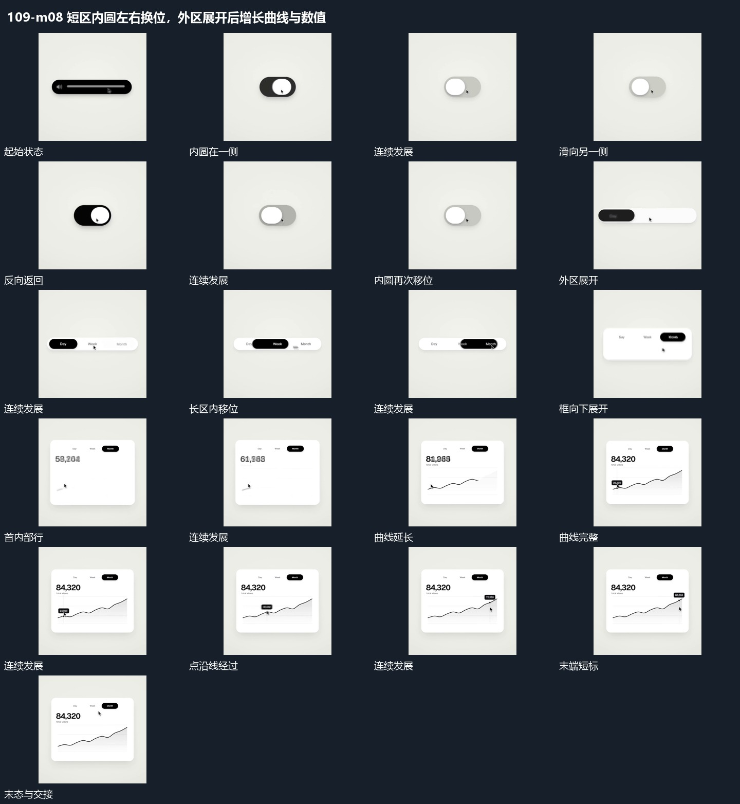

# 短区内圆左右换位，外区展开后增长曲线与数值

## 运动指令

小圆在短区左右换位并带动底层换态，外区拉宽；由这一横条向下打开宽框，曲线与数值逐项建立，小点沿线移动并带出标注。

1. **短区内圆左右滑动再把外区横向展开**

短外区保持，内圆从一侧滑向另一侧，接近端部时减小位移，再反向返回。之后外区向横向展开，原内圆拉长为小片并沿多个位置移动；其他位置短行依次建立。

2. **框内曲线逐段描出小点沿线经过并带动短标**

框向下展开后先补内部主行，再从曲线一端逐段描到另一端。曲线完成后小点沿线移动，垂向短标随点位置更新，旁侧数值在同一标签范围接替；框与主行保持。

整段结束：完整曲线与局部短标 保留必要落稳与交接，中间已建立的参照沿用到下一步骤。

## 视频切片

[播放本机制的原片切片](m08.mp4)

保留起始准备、连续发展和完成或明确交接；首尾按本段运动范围裁切，不拼接、不变速。相连的小动作合为同一完整段落。

## 分镜过程

## 组合与调整

小圆在短区左右换位并带动底层换态，外区拉宽；由这一横条向下打开宽框，曲线与数值逐项建立，小点沿线移动并带出标注。 复用时可调整元素数量、幅度和相对节奏，保留上述进入、交叠与完成关系；不直接沿用原片题材或时长。

位置数量按需要变化；滑动沿同一内部范围，不让内圆跨越外边界。

路径先建立再移动小点；短标仅跟随所在局部，不带动整框。
