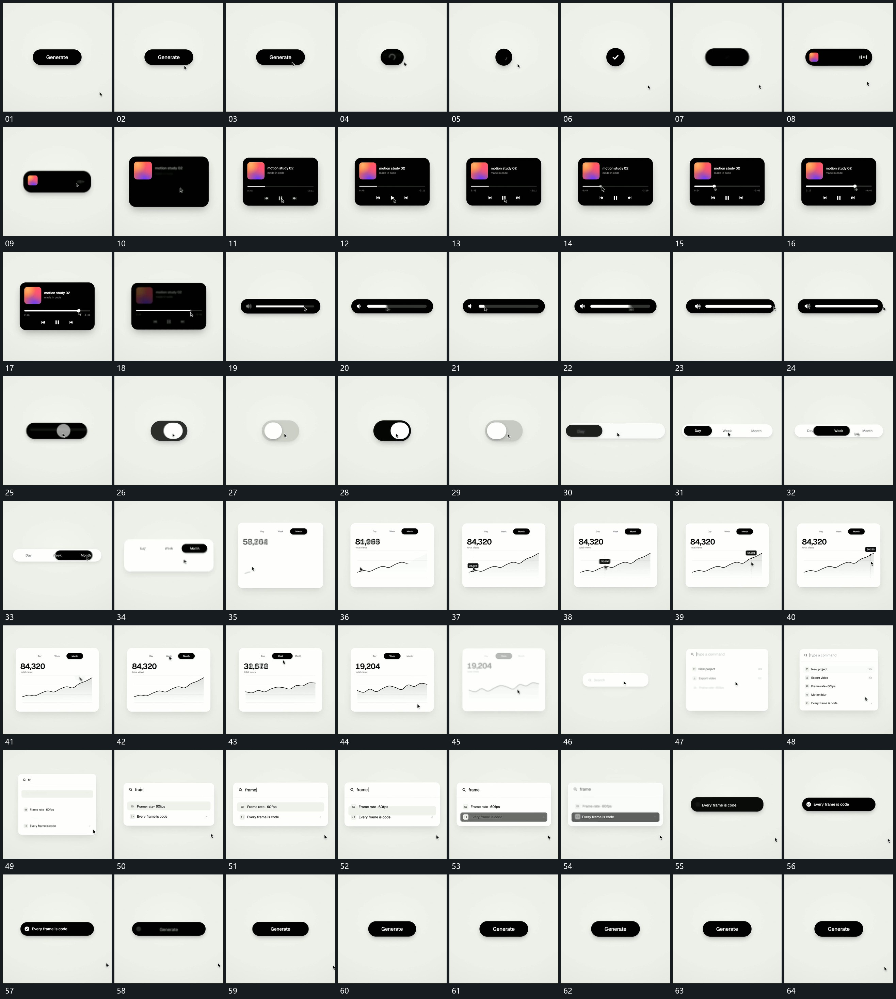

# 109｜原片运动总览

[观看完整原片](video.mp4)

## 运动总览

全片以宽条收成圆区再伸展并向下打开宽框让宽条收成圆区，再横向伸展并向下展开成宽框。框内长线端点沿线移动经过范围留下填充沿长线移动端点，经过范围留下填充；随后宽框压低收成细条原长线仍保留压低框高，收成细条并保留原线。

细条进一步收短后短区内圆左右滑动再把外区横向展开让内圆左右滑动，再展开为多区长条。长条向下展开时框内曲线逐段描出小点沿线经过并带动短标描出曲线并让小点沿线经过。末段列表逐项减少外框随内容收小最后回成短条逐项减去列表、随结果收小外框，再将外框收成短条，回到初始宽条状态。

## 完整运动段落

以下按原片中的出现顺序引用。建立、内部发展及完成反馈放在同一段中；同时发生的局部动作与运镜写在同一份指令里。不同段之间可以是连续接管，也可以是直接切换，不能仅凭条目相邻认定可直接拼接。重复出现的同类运动采用一次连续代表范围，切片不以逐段无缝覆盖整片为目标。

1. [短条收圆再展开宽框，内线增长后连同内容压回短条](mechanisms/m07.md)：短条收缩为圆区并完成局部反馈，圆区展开成长条再向下打开宽框；框内长线沿轴增长，内容随后退弱，宽框压低收回为短条而细线仍保留。

2. [短区内圆左右换位，外区展开后增长曲线与数值](mechanisms/m08.md)：小圆在短区左右换位并带动底层换态，外区拉宽；由这一横条向下打开宽框，曲线与数值逐项建立，小点沿线移动并带出标注。

3. [列表逐项减少外框随内容收小最后回成短条](mechanisms/m06.md)：减项收框再回收

切片保留起始准备、必要内部停顿和完成或明确交接；首尾省略无新发展的等待，持续运动不要求人为停住。以上基于真实源帧序列和重点边界核对，不等同于全片连续声画审片。

## 完整64宫格

