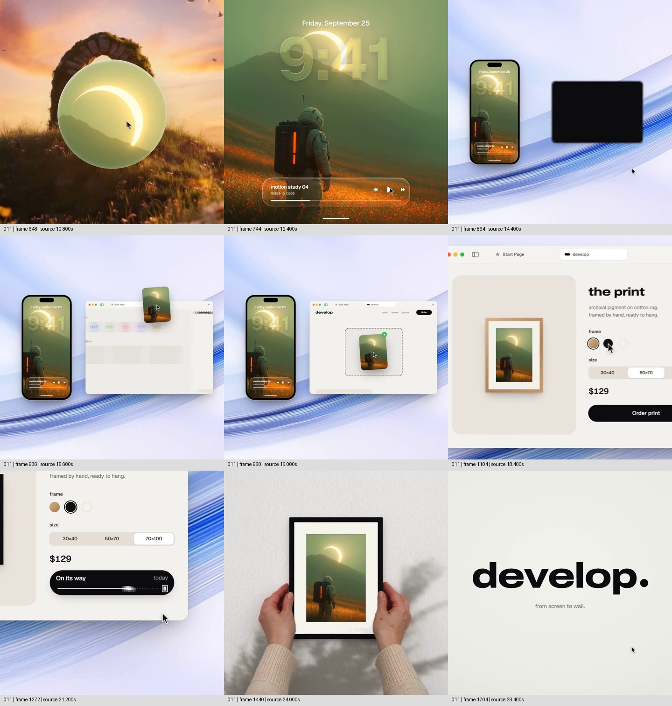
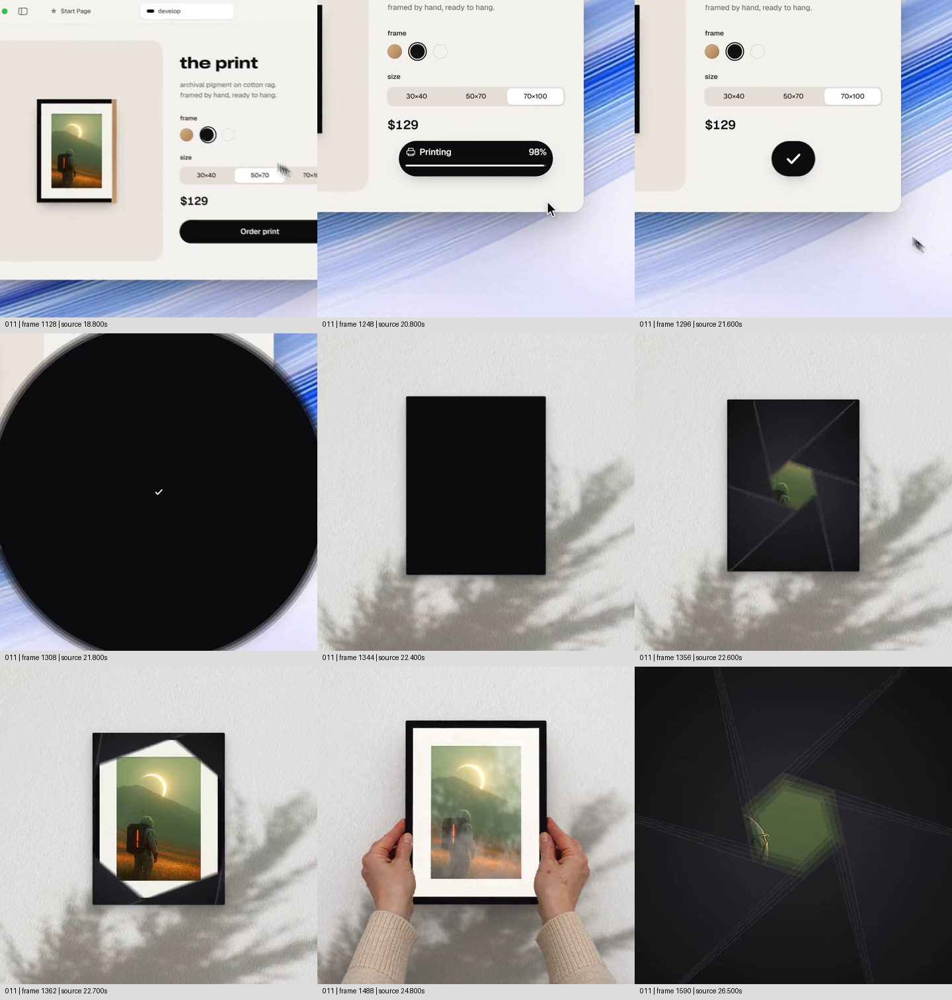

# 让同一幅图跨过屏幕与订单，最后成为手中可感的画框

来源：案例011《照片到手机，再到画框》，索引作者 twoclipping，画内品牌 develop.。[来源页面](https://skillry.dev/ai-videos/opus-5-5/twoclipping-496100)。

范围：完整原片 **[10.200, 29.077)秒**。[完整原片](../video.mp4) · [本卡完整片段](c01-restudy.mp4)。片段内时间＝源时间−10.200秒。

观察方式：2026-11-05依据定稿版重新从原片抽取每0.4秒定位帧及末帧；另查9.9—11.2、21.4—23.0、26.4—27.6秒每0.1秒的关键中途，重新选取本卡分镜。**frame-only，未原速连续观看、未听审**。照片、界面、墙面和双手均为片中可见材料，不认证其拍摄或生成来源；订单、价格、制作与配送文字仅为原片演示，不证明真实服务能力。近似秒点描述状态范围，不冒称精确运动曲线。

补图源帧：1128、1248、1296、1308、1344、1356、1362、1488、1590；源时间依次为18.800、20.800、21.600、21.800、22.400、22.600、22.700、24.800、26.500秒。

## 1. 原画面具体怎样设计

**先重新建立一幅图，再揭示它在设备里的用途。** 本段从前一幅石拱门的调节结果进入：10.2秒之后底部控件退去，圆形透明区域向画面中部发展；约10.6—11.2秒，它显出绿色山地、发光月牙和背着橙色灯条背包的人物，扩大后接管整幅。这里已经换图，不能写成石拱门一路被打印。新的宇航员图先让人看清内容，随后上方叠入日期与9:41，下部出现带曲名与播放图标的玻璃状组件。影像从完整风景变成锁屏背景；日期、时间、下方横线一起提供设备语境，未听审不能据播放图标断定音乐正在响。

约13.2—14.4秒，锁屏从满幅缩成完整手机，手机移向左侧；周围显出浅蓝白、带斜向流纹的背景，右侧出现黑色圆角块并建立浏览器窗口。缩小带来的新信息是“刚才占满画面的内容属于手机屏幕”，不是单纯把同一画面做小。手机与网页在同一个舞台并置，留出的中间空间供后续跨越。约15.2秒，宇航员图的小卡出现在手机旁，15.6秒位于网页上方，16.0秒落在网页虚线接收区，带绿色确认点。手机仍保留原锁屏，而跨出去的图没有日期和播放器文字：视觉上转交的是图像内容，而不是把整套屏幕界面做成了海报。

**接收成立后，网页取得主位，观众从交接转到配置。** 16.4—17.2秒，网页扩大，手机移出主要观察范围。左侧 from screen to wall. 的大字与右侧宇航员图共同建立服务承诺；随后网页来到 the print 商品区，左侧出现带白色内衬的画框预览，右侧为框色、尺寸、价格和 Order print。约18.4—18.8秒，指针到黑色选项附近，木色框转成黑框；之后70×100选项被选中。这里可以确认选项与框色状态，不能仅凭镜头靠近就声称尺寸选项使实体同比例长大。图中月牙、山线、人物与背包亮条持续可辨，承担贯穿流程的身份线索。

**把几个订单状态集中在同一块区域，直到它接管环境。** 约19.6秒指针靠近 Order print，随后黑色按钮内部先为加载符号，再依次见 Ordered、Printing及百分比、On its way与运输图示。约21.6秒，长条收成白勾黑圆；约21.8秒黑圆扩大，遮住网页与背景，21.9—22.1秒接近全黑。22.2—22.5秒，黑形退成墙面的竖矩形，周围显出白色墙面颗粒和斜投的枝叶阴影。22.6—22.8秒，黑矩形内部出现分瓣开口，宇航员画面与白内衬由中部显露，成为黑框成品。不是勾选后直接切一张新产品图，而是让“已完成”的黑形在遮住环境之后，为成品轮廓留下位置。

**最后把网页里的商品变成有尺寸、厚度和持握关系的物件。** 约23.2秒双手从下方两侧进入，23.6—24.0秒握住画框侧边。指尖位于框前、手掌和衣袖连到画面下缘，画框与墙面、投影形成不同层次。24秒之后，框内表面可见亮斑与反射变化，画框和手在视野中变大，25.6秒后框边逐渐越出，26.0—26.4秒又回到宇航员图的局部。反射给出玻璃表面的外观线索，但不据此认证真实材质或拍摄方式。26.5秒出现分瓣黑形收拢，继而黑色块、胶囊、小点，约27.5秒后重见 develop.，最后保留品牌和 from screen to wall.。

整段空间不是始终不变：图像先是世界，继而成为屏幕内容、跨设备小卡、网页商品、墙面成品和手中物件。同图身份维持，承载它的环境与观看尺度改变。手机、网页和双手逐次承担新的解释，不必同时堆在一帧里。前面的数字流程给后面的实体展示提供对象与结果依据，结尾再把物件展示收回品牌；跨场景的关系因此在一张卡里完成。

## 2. 为什么这样设计，好在哪里

主创意是**让一个已认识的数字内容，在不同载体之间保持身份，并最终得到可以看见的实体回应**。from screen to wall. 不只是一句口号：手机交出图片，网页接收并配置，订单给出完成状态，墙面与手接住成品。每一站都增加一种不同的信息——来源、去向、选择、过程和实际呈现——而不是给同一张图反复换边框。

宇航员图适合承担这条主线，因为它有跨尺寸仍容易辨认的组合：上方发光月牙、斜山线、下方人物及橙色背包灯条。手机裁切、网页缩略图与纸面留白并不完全相同，但这些身份线索一直能对应。真正需要保留的是图像身份和合理裁切，不是让所有载体都使用完全相同的矩形比例。若换成每一站都不同的图片，就只剩产品功能拼盘，成品无法回答“我刚才选的东西去了哪里”。

并置两设备是交接成立的空间条件；小图跨越与接收确认让来源、目标和完成状态能一起被读到。网页之后放大，则主动结束交接阶段，把注意转向配置。订单始终使用一处黑色条形区域，状态改变时视线不用反复寻找；它缩为完成标记再铺满，为从屏幕空间跳到墙面隐藏了环境转换。黑形在墙面留下竖框、框内再显图，使完成状态和成品显露形成接力。删去这一段仍可用普通切换讲清故事，但会减少“过程亲手交出结果”的观看联系；它是有价值的支撑设计，不能被误认作打印过程的真实记录。

墙面颗粒、树影、白内衬、手指遮挡及表面反光共同把末段和网页预览区分开。手不仅作装饰，还提供大小参照和持握接触，使“可拥有的成品”更具体。拿掉实体环境与接触，只把网页里的画框放大，承诺就停在另一张预览图。握持阶段的必要观看时间应由接触和成品是否看清决定，不能因为完成勾已经出现就立刻收尾。

暖白、黑色胶囊、蓝色流纹和玻璃界面是可变外观；分瓣遮罩、缩放、合成等属于可能的实现手段，不能反推作者源码。关于黑形遮换与手中成品的观看价值是作品分析，不声称作者真实意图；快速状态在原速下是否读得清、触碰是否自然、声音是否帮助落点，仍需连续声画观察。

## 3. 可直接使用的创意指令

用这条方法表现“数字内容获得真实交付结果”时，先选一个值得观众持续追踪的具体内容，并准备它在各载体中的对应材料。构思的关键不是设备数量，而是每换一次环境都回答一个新问题：内容原来在哪里、交给谁、怎样选择、何时完成、最终是什么。以用户照片成为印制明信片为条件性例子，应准备同一照片、可核实的下单界面或明确标为示意的流程、明信片正反面与实际持握材料；没有成品材料就不能把任意另一张纸片冒充结果。此处只提供设计映射，未做迁移测试。

先用足够大的画面让人认识照片，再通过显出相册或设备边缘说明它属于哪里；若来源一开始就清楚，可省去这次揭示。交接时把源与目标放在同一空间，给内容副本一条可见路径，源侧保留必要参照，目标侧用真实接收状态或明确示意反馈确认。等交接完成，再让源端退场、接收端占据主位，不同时要求观众看小图飞行、阅读规格和辨认产品材质。不同题材可以把手机与网页换成设计画板与生产预览，但新的载体必须有实际内容关系。

配置阶段只突出会影响最终结果的选项。控制改变后让对应预览更新，保留这张内容的识别特征；镜头可以靠近控件帮助阅读，但不要把靠近误作产品尺寸改变。将必要的处理状态放在稳定区域，给它们与项目复杂度相称的阅读窗口。原片把制作和运输压缩成几秒，迁移时必须按真实叙述处理时间跳跃，使用清楚的示意或省略表达，不能暗示现实制作和运输即时完成。

从完成状态进入成品时，可让状态标记扩大遮住旧场，再收成与新物件有关的轮廓，由内部显露内容；也可以换成其他能让新环境建立的动作。保留的是“完成反馈交出结果”，不要求照搬黑圆或分瓣形状。实际成品必须能核对同图内容、裁切和方向，边框、纸张、阴影及手指前后关系共同建立物件；让接触成立、成品看清，再决定推近细节或收回品牌。没有手持材料时可采用真实桌面、墙面或交付现场，不能只加一只无接触关系的手形图标。

内容链和同图身份有依据才算满足；设备布局、转交路径、结果的取景与阅读时间可通过设计满足；没有对应成品、关键过程不真实、素材分辨率不足以持续辨认、或各站裁切丢掉身份线索，则不满足，应补材、缩短流程或改为明确的概念演示。保留对象身份、每站的信息增量和最终回应，外观、载体数、动作技术与收尾品牌方式均可重做。若去掉成品后整段表达仍完全一样，就应重新检查交付结果是否真正参与了创意。

迁移状态：**原片拆解（frame-only）；连续观看与听审未完成，未进行新题材制作验证。**
