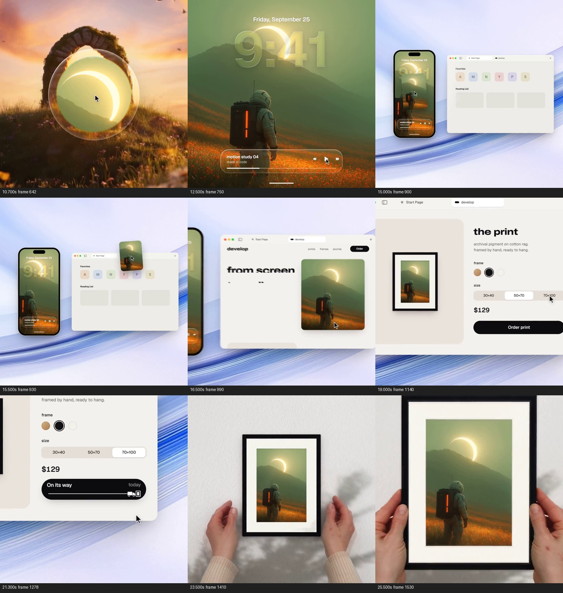
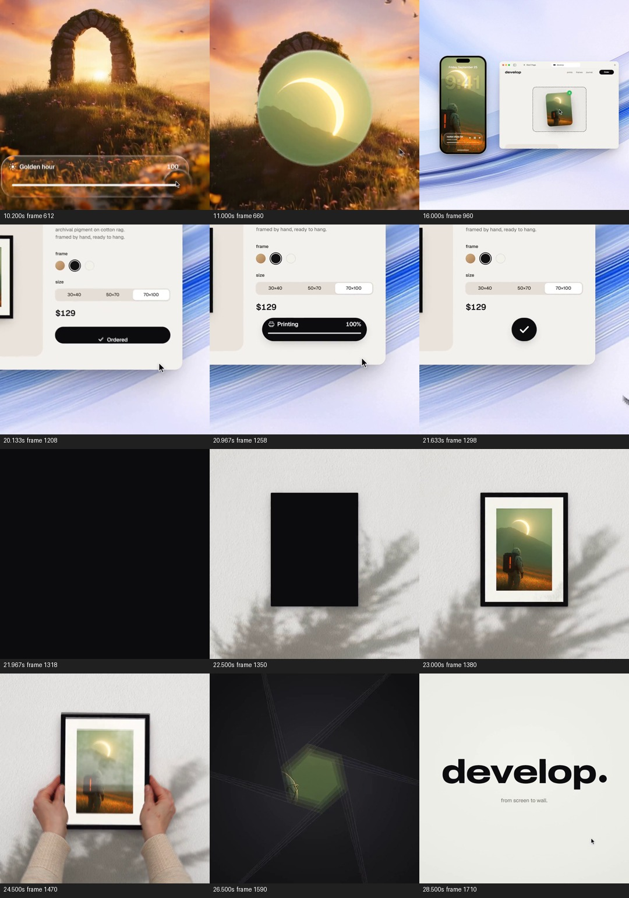

# 让同一张图走过手机、网页与手中的画框

来源：案例011《照片到手机，再到画框》，署名 twoclipping；[来源页](https://skillry.dev/ai-videos/opus-5-5/twoclipping-496100)。

范围：完整原片 [10.200, 29.077) 秒。时间均指原片；切片内时间须减去 10.200 秒。

[完整原片](../video.mp4) · [本卡完整片段](c01-restudy.mp4) · [当前拆解总览](overview.md)

观察方式与限制：frame-only：本轮重新提取并观察全片每0.5秒源帧与末帧，另核对关键局部源帧。未完成原速连续观看、慢放播放或听审；不能确认采样间隔内的完整运动、原速节奏与声画同步。技术手段和外部素材来源未经作者工程核实。

本轮依据用户指定的《创意卡拆解指令·最终修订版》重新观察、重新写作；旧创意卡正文未作为底稿。当前文件是本ID在派生索引中的唯一正文入口，保留的旧文件不代表另一张当前卡。分析结论不是作者自述，也不是观众效果实验。

补充核对：本轮还看了1.8—4秒每0.2秒、10—11.4秒每0.1秒、10.166667—10.35秒逐帧、19.8—22.133333秒每10帧的源图。

补充分镜源帧：612、660、960、1208、1258、1298、1318、1350、1380、1470、1590、1710；源时间依次为10.200、11.000、16.000、20.133、20.967、21.633、21.967、22.500、23.000、24.500、26.500、28.500秒。

## 1. 原画面具体怎样设计

本段开始时，上一张石拱图已经完成暖色调节。10.2—约11.4秒，底部滑杆收走，一个玻璃球状圆形区域从下方向上移到主要观看区，先透出原来的石拱，随后圆内改为绿黄色山景中的明亮月牙状天体；圆区域扩大，接管全幅，露出背对观众的宇航员与橙色花地。这里确实更换了图片，不能写成石拱图经过调色变成宇航员，也不能说后续打印的是前段选中的石拱照片。

约11.4—13.4秒，宇航员图暂时作为大画面，随后上方增加日期、“9:41”大数字，底部增加写有“motion study 04”的播放控件与短横线。数字半透明，图中明亮天体与天空仍能被看见；它们把原本供欣赏的图变成了手机锁屏内容。接着整个画面收小进一部竖手机，手机落在浅蓝色弧线桌面背景上。观众先认识图，再认识它当前被哪一种设备承载。

约13.4—16.4秒，手机让到左侧，右侧出现横向浏览器窗口，先是黑面，再显出起始页内容。两个容器同时留在画面，给跨端传递建立起点和终点。宇航员图片以独立小卡从手机附近提起，倾斜着跨过桌面，落到网页中的虚线接收区；图卡旁出现绿色确认标记。手机仍显示同一图像，因此画面表现的是内容被取用或传入另一端，不能据此断言手机原文件被删除，也不能证明真实系统支持这次跨设备操作。

约16.4—19.6秒，网页逐渐占据主画面，手机被挤到边缘并退出。网页左侧写出“from screen to wall.”，右侧继续使用宇航员图，之后页面向产品配置区域推进：左边是带框预览，右边是“the print”、框色圆点、尺寸选项、价格“$129”和“Order print”按钮。鼠标选黑色框，预览从木色边框变成黑框；再选“70×100”，选中态更新。框色变化直接可见，不能仅凭尺寸文字就断言实物尺寸或比例在镜头里被准确模拟。图像本身保持身份，关注对象由“我的数字图片”转成“将要得到哪种成品”。

约19.6—22.2秒，观察区域靠近订单按钮，原来页面的大部分信息逐渐退到外围。黑色长条在同一位置依次显示加载、Ordered、Printing与百分比、On its way与小运输图形；最后收成带对勾的黑圆，黑圆再扩大覆盖画面。状态文字和进度把制作、配送压缩成一次可读的等待过程；它们是片中的演示状态，不是已验证的实际订单、生产耗时或配送承诺。小字快速变化是否都能在原速看清，本轮未确认。

约22.2—25.6秒，黑色遮挡之后出现白色纹理墙与枝叶投影，中央先有黑色长方形，再显出黑框、白色卡纸内衬和同一张宇航员图。此处不是网页边框一直裸露着无缝移动到墙上：两者之间有覆盖全画面的黑色过程。相同内容和黑框样式负责让观众重新认出刚才选过的成品。随后米色袖口的双手从两侧伸入，握住框边；画框随手部姿态变化，约24.5秒表面出现一层反光，之后画框靠近，图像越来越大。墙面材质、树影、手指遮挡和表面反光一起让成品具有环境、尺度与可触摸的表观，素材是否实拍、生成或混合未经核实。

约25.6—29.077秒，画框靠近至边缘离开画面，视野进入图像；随后出现类似孔径叶片的收拢图形，黑形回到暖白底，最后恢复“develop.”及“from screen to wall.”。29秒是最后一张视频帧，视频流到29.016667秒，音频尾部延续到29.077秒。结尾不是新的独立功能，它把刚展示的过程归回品牌，并与开场黑形和孔径建立呼应。

整段先把一张图作为可欣赏内容建立，再让设备、接收区域、配置界面和生活环境轮流成为它的载体。主次转移有具体依据：跨端时保留两个容器以便认路，配置时扩大目标端以便读选项，完成后退出界面，用手与墙面确认结果。没有需要观众一路追读的长段旁白字幕；片中可见文字承担设备身份、产品承诺、选项和状态说明。本轮未听审，声音承担何种作用仍未知。

## 2. 为什么这样设计，好在哪里

主创意是用同一图像的身份，组织一次从“我已经拥有的数字内容”到“我可以拿在手里的成品”的价值变化。它不依靠把手机、网页和画框三个场景并排罗列，而是逐次回答图在哪里、怎样进入下一端、下一端决定什么、最后能看见什么。宇航员背影、橙色背包亮条和上方明亮天体构成反复可认的特征；这些特征在小卡、手机和画框里都保留下来，才使跨载体关系容易成立。

手机与网页并置是关键支撑：小图实际跨过两者之间的空处，把抽象的传递变成有方向的动作。接收区确认后，网页才扩大，注意力转移有明确交接。若拿掉源手机，只展示网页内一张图，便失去“从自己的设备带入”的含义；若三处用不同图片，即使转场相同，也只能表达几个产品场景，无法表达同一内容被兑现。

网页预览、状态长条和实物画框承担不同任务。预览说明选择如何改变成品；长条把等待压在一个固定区域，不必每个状态另开一页；墙面与手部让界面中的结果获得生活尺度。黑圆覆盖提供了换环境的遮挡条件，但真正维系结果的是图片身份与所选框型，而非黑圆本身。若去掉手部，仍能表达上墙效果，却弱化了尺寸和握持感；若去掉墙面与成品，只以对勾收尾，则完成的是提交反馈，不是“从屏幕到墙面”的承诺。

浅蓝桌面、米色袖口、黑白包装和具体字体是气质与识别的选择，可以替换；反光和投影是帮助实物成立的支撑，而非必须照抄的装饰。镜头或画面尺度变化的功能始终随任务变化：锁屏缩小揭示设备，网页放大使配置可读，成品靠近让观众看见所选图像的实体呈现。这里只能确认最终画面的缩放、遮挡与移动，不能据此判断原作是否使用真实摄像机、三维空间或二维合成。

## 3. 可直接使用的创意指令

用于展示同一内容从数字源头经过配置走向成品的任务。先选一个跨尺寸仍容易认出的内容对象，准备其在源设备中的呈现、可展示的接收或配置界面，以及实际成品或明确标注性质的成品示意。让主要图形、人物姿态或色块关系保持一致；提前检查不同容器的裁切会不会删去识别特征。若只有三张彼此无关的漂亮图，不能用这个方法假装建立同一内容的生产链。

入口先给观众认识内容的机会，再揭示它位于源设备。需要跨端时，把源端和目标端同时摆入画面，让一份可辨认的内容从源位置移动到目标接收区；移动中保持身份，落入后给明确反馈。只有接收完成，才让目标端放大并让源端退出。接下来用少量真实相关的选项改变预览，例如框型、封面材料或模型部件；选项与预览同时可见，避免在观众比较时加入额外主动作。

配置完成后，把注意力收至一次提交动作及其状态。若使用压缩演示的制作或配送过程，要让语境说明这是演示，不虚构真实耗时。用一个短而明确的遮挡或场景切换进入成品端，保持内容识别特征和已选配置。成品必须有承担结果的环境与尺度参照：墙面用于判断上墙关系，手部用于判断拿取和尺寸，桌面用于判断摆放；根据产品选其一，不必全加。给结果一个可观察的阶段，再结束品牌或交给下一段。

例如迁移到“数字封面成为一本书”，原片手机中的图对应封面源稿，网页接收区对应印制配置，框色对应封面材料，手中画框对应翻看或拿起的成书。需要改变的是容器和实物动作：封面与书脊裁切必须对应，纸页厚度与手部握持应成立，不能直接把画框矩形替换成一本没有体积的书。此例仅说明映射，不表示已有这些素材。必须保留的是同一内容的可认性、两端传递依据、选择对结果的影响以及最终可观察的成品；外观、载体数量、过渡形状和代码均可重做。若没有成品素材或配置与成品不能对应，应把表达收在数字预览或提交成功，另选创意，不用虚构实体结果补完承诺。

迁移验证状态：**原片拆解（frame-only，连续观看验收未完成）**。未制作新题材样片，未验证迁移效果。
