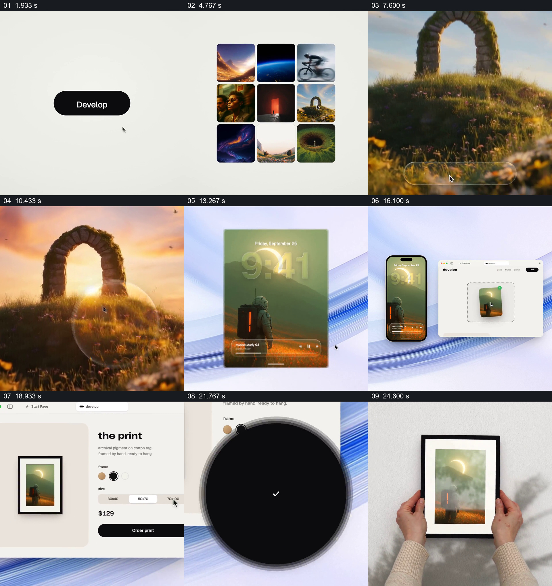

# 让同一张图从手机与订单走到墙上画框

- 作品：案例 011《照片到手机，再到画框》（索引名称）。
- 原片范围：00:01.500–00:27.000，含起点、不含终点；[完整原片](../video.mp4)｜[本卡片段](c01.mp4)。
- 观察方式：依据整片 64 宫格和约每秒一次的真实源帧观察，未连续原速观看或听审；声音、语气与完整播放节奏未确认。

## 原画面具体怎样设计

白底按钮引出图片集合，一幅拱门景观放大，画面下方出现调色控件并改变画面色调。随后另一幅人物与日蚀图进入手机屏，手机与桌面窗口并列，网页展示“from screen to wall.”和画框商品配置；订单进度完成后画面变黑，墙面出现带同一人物图像的画框，双手在两侧扶住画框，最后视野进入框内图像。

## 为什么这样设计，好在哪里

同一幅人物图像在手机、网页商品和墙上画框中反复出现，给跨媒介过程一个可核对的连续对象；双手接触实体框让最终用途具体可见。前段拱门图是选择与编辑示例，不能误称它与后续印刷图为同一张。

以上为依据画面的分析，非作者自述；预期观看效果未经观众测试。

## 可直接使用的创意指令

当需要把数字内容的加工、订购和实体结果连起来时，选择能够合法使用的同一图片或作品，明确它首次被选中的位置；在后续设备、配置界面和成品镜头中保持可辨认的内容一致，展示必要的裁切或参数选择，再用真实的实体环境或标明示意的画面呈现最终使用。若前段另用示例展示编辑能力，要明确两幅素材的区分，不能虚构它们是同一张。
