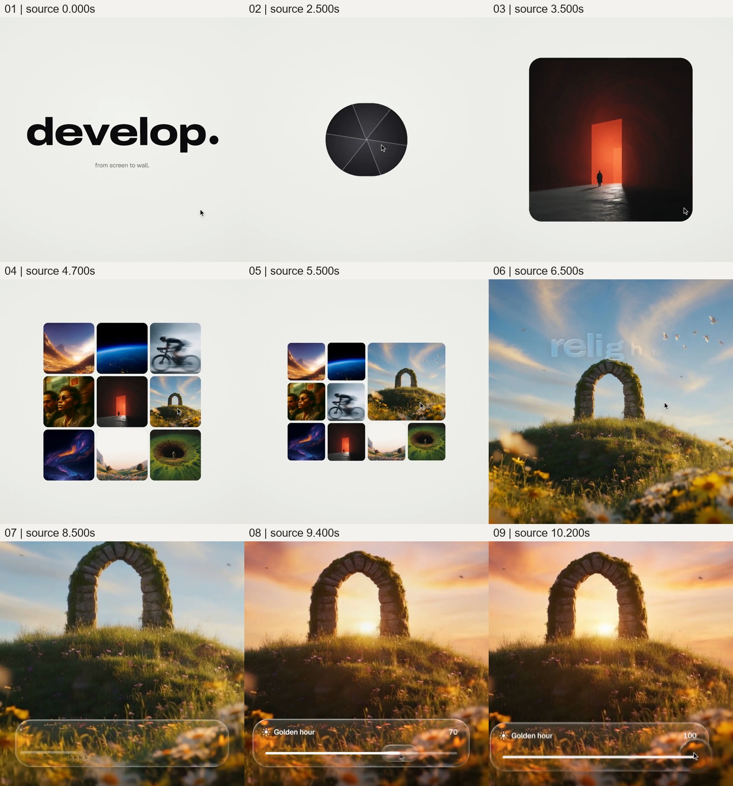

# 让候选图像成为操作现场，用同景变化展示调光结果

来源：011《照片到手机，再到画框》，作者 twoclipping；[来源页面](https://skillry.dev/ai-videos/opus-5-5/twoclipping-496100)。

完整原片：[011 原片](../video.mp4)；本卡片段：[观看片段](c01-general-redo.mp4)。

范围：原片 [0.000, 10.300) 秒，起点包含、终点不包含。

观察方式：本次核看完整原片的 64 帧总览和本卡九宫格，正文沿用此前已整理的案例创意卡，并对照上述源帧；并非本次从零重做全部观察。原卡记录了此前浏览器原速播放时的连续截图、全片每 0.5 秒源帧及关键交接加密取帧，该历史记录不冒充本轮操作。

观察限制：本次未独立完成连续原速观看；历史截图序列也不能等同逐帧连续观看。本次未实际听审，不判断音乐、音效或声画卡点。素材来源、制作技术和界面功能真实性未确认；下述迁移方法尚未在新作品中验证。

## 原画面具体怎样设计

暖白底上先出现黑色 `develop.` 字标和下方很小的 `from screen to wall.`。字标消失后，黑点扩成圆角胶囊，出现 `Develop`，指针在附近活动。胶囊接着成为带放射分区的暗色圆盘，内部露出红色巨大门洞与门前小人物；图像从圆形区域展开成圆角矩形。这里先给出一个可操作入口，再把入口交给可观看的图片，尚未展开完整界面。

约 4–5 秒，红门图缩小，其他图片加入，形成三行三列的候选网格。图片包含山谷、地球边缘、骑行者、人像、星云、石拱门等，主体形状与色彩不同，确实构成可挑选的集合。指针移至石拱门图后，它在原来的右侧区域扩大；周围图缩小、重排至左侧及下方，红门图也让到下排。选中项不是被另一张大图突然替换，而是在仍能看见候选关系时取得更大面积。

约 6 秒，石拱门图进一步接管方形画幅。蓝天、云、草坡、花草和山丘上的石拱门建立为新的观看现场，原网格边界退出。半透明大字 `relight.` 浮在上部天空区域，随后观察范围靠近拱门及前景，拱门上缘一度接近或超出画面。下方透明圆角条浮现，含分享、爱心、信息和调整图标，爱心呈填实状态；工具条没有另开大面积面板，前景花草仍透过它可见。

约 8.5 秒，底部条变为 `Golden hour` 调整条。滑块向右，数值上升至 100；同时天空由蓝转暖橙，拱洞内出现低位亮太阳，花草和石面染上暖光。拱门、坡地和花丛仍可辨认，因此能直接比较同一景物的变化，而不是只看到参数变化。到约 10.2 秒，滑杆到达右端，暖色结果完整呈现。本卡到 10.3 秒结束；接下来的透明圆形区域换入另一张宇航员图，由下一卡承接，不能把它当成石拱门的又一种调光结果。

整段观察范围从单个入口展开成候选集合，再收敛到被选中的图像，最后收敛到图像的一项可变属性。图像越接近操作主角，周围容器和候选就越退让；控件在素材已足够大、变化可以被辨认之后才进入。时间主要用于入口展开、候选选择和调光过程；精确速度曲线与声音节拍未确认。

## 为什么这样设计，好在哪里

主创意是把“选图—调整—看到结果”组织成同一观看过程，让被选择的素材逐步成为整个操作现场。网格提供选择的上下文，原位扩大保留选择与结果的对应关系，全幅图像提供观察变化的面积，底部控件则把动作和结果放在同一视野内。这几步各自改变一个关系：谁被选中、谁取得主导、什么属性正在改变，观众不用在列表、说明文字与结果页之间重新寻找对象。

石拱门图不是任意配图。石材轮廓和坡地结构负责维持对象身份，天空、太阳和草地受光负责呈现被改变的属性；拱洞还为亮太阳提供清楚的视觉位置。若换成没有可辨光照差异的平面图标，滑杆仍能移动，但“调光”失去可以观察的结果。反过来，若调整前后更换了构图或主体，观众也难以把差异归于这次操作。同一对象的稳定结构与可变表面，必须同时存在。

构图的连续改写比放大动作本身更有价值。候选图缩小重排，是对选中项让位；全屏以后工具条占据下方小区域，是让操作依附于图像；透明材质又保留前景纹理，使控件不会彻底截断观看。`relight.` 提示当前能力，`Golden hour` 和数字指出正在变化的维度，它们属于画内功能文字，不能替代石拱门从冷到暖的视觉反馈。

字标、黑胶囊、圆盘和圆角图框是支撑入口连贯性的设计，浅色底、具体字体与控件皮肤可以更换。真正不能删的是选中项与大图的身份接续，以及操作与可见变化的对应。直接切到一张暖色成图只展示了结果；只播放滑杆动画则只展示了操作。原片把二者连在一起，才把能力从一句宣传语变成可观察的过程。这仍是片内演示，不证明背后的软件具备真实实时调光功能。

## 完整照排指令

以[完整原片](../video.mp4)的 0–10.3 秒为准。画幅 1280×1280，源帧率 60/1。以下拍点为抽帧定位，位置按画幅百分比取近似值。

### 用料

- 【开场字】【候选图集】【选中场景】【控件名称】【调光选项】【下一图】【手机叠字】【后景纹理】。图集备九幅足够可辨的候选，其中【选中场景】是后续放大的原图。场景宜有明确的天然框景、前后地面层次与可读光源位置。
- 备同场景统一构图的冷中性和暖光两版，草地、石拱、远景等保持坐标，调整光色、亮区与对应阴影。若展示实际功能，提供相同输入的前后文件和可核对演示。下一图另取竖向主物和高位亮光，可放入手机。

### 按源时刻摆放

1. **0.000–约 3.000 秒。** 浅灰白满幅，居中黑粗【开场字】缩成黑色圆角胶囊，再靠中心收成带细放射线的小暗圆。暗圆转为居中方形圆角图，黑暗场景内有暖色局部。留大片浅底，四周不加说明牌。
2. **约 3.000–5.800 秒。** 中部展开三行三列【候选图集】，方圆角、窄白缝，保持同一基线。选择右部的【选中场景】，由原格放大并向右凸出，其他小图仍在左后方短留，直至被大图覆盖。不要用无关素材接全屏。
3. **约 5.800–9.500 秒。** 图像铺满，中央拱顶与中下地面保持构图。主景由冷日光展示开始，中下加入透明细边长控件，内用小浅色【控件名称】及【调光选项】，另备短亮进度线。景物固定，暖光从拱口和天空变亮，改变前景与背景光色。随后透明圆形对照区在图上可见；圆边须显示同一景物的色光差异，不能画成漂浮光球。只做颜色示例时允许静帧状态连续插值，实际曝光过程用可追溯操作。
4. **近 9.500–10.300 秒。** 按索引切出。若边界已露【下一图】，保留绿金背景与主物作为下一卡入口；【手机叠字】和【后景纹理】仅用于后续手机展开，避免提前并入调光画面。

### 局部采用

只具备同景前后时可取约 5.800–10.300 秒，在下一图出现前切。只采用候选选择可取约 3–5.800 秒，须确有能读清的放大原图。

### 验证状态

已对照逐秒原片画序并读回，核对图组原格被选、同场暗暖变化与透明控件。光色转折的精确帧、原速听看、末端邻段边界及换料待核。
