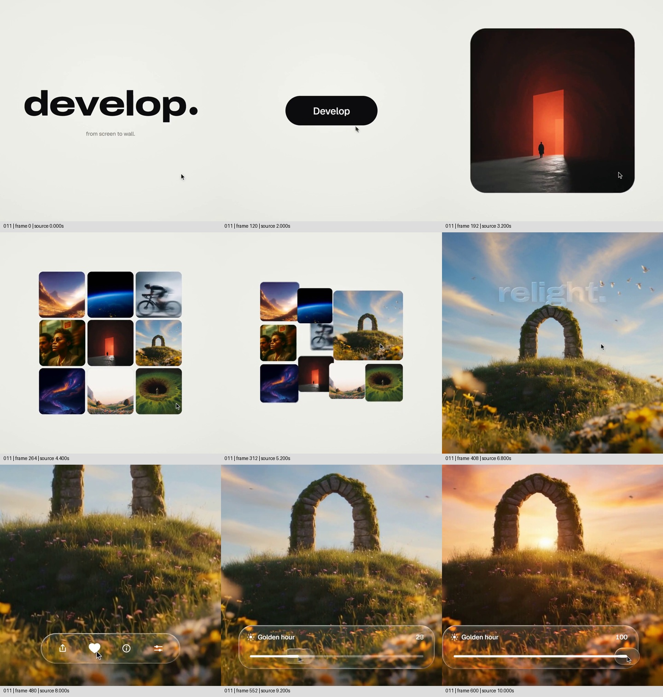

# 让被选中的风景成为操作现场，把调节直接演给人看

来源：案例011《照片到手机，再到画框》，索引作者 twoclipping，画内品牌 develop.。[来源页面](https://skillry.dev/ai-videos/opus-5-5/twoclipping-496100)。

范围：完整原片 **[0.000, 10.200)秒**。[完整原片](../video.mp4) · [本卡完整片段](c02-restudy.mp4)。片段从零播放；分镜标注均为原片时间。

观察方式：2026-11-05按《创意卡拆解指令·定稿版》重新提取源帧并独立写作；本段每0.4秒定位，另查9.9—11.2秒每0.1秒的交接上下文及本卡选帧。**frame-only，未原速连续观看、未听审**。分段秒点用于还原主要状态，不认证逐帧启动时刻、速度曲线、原速可读性或声音同步。图像与界面为片中呈现，素材制作来源和产品真实功能未独立核实。

## 1. 原画面具体怎样设计

**入口先给品牌，再交出可操作对象。** 0—约2.4秒是暖白底上的黑色 develop. 字样，下有小字 from screen to wall.。主字缩小，随后中央出现短黑形、横向胶囊和白色 Develop 标签，指针靠近它。画面没有同时展示一整套应用界面：大面积空白把黑色入口留作唯一中心。之后黑色胶囊附近显出一幅红门图像，圆形可见区逐渐扩成圆角矩形。约3.2秒，红色发光门、暗室和小人物占据画面中心，观众先认识了一张具体图片。

**这张图不是被直接替换，而是退成图库的一员。** 约3.8—4.8秒，红门图缩小并保留在中间，周围陆续补入山地、地球边缘、骑行者、人像、石拱门、抽象色流等图块，最后形成三列九格。图片具有不同色块与轮廓，所以既能读成丰富候选，也能追踪某一格的位置。约5.2秒，右侧中行的石拱门图变大并覆盖部分邻近位置，周围图块让位；随后这张图扩大到满幅。前一阶段的多图浏览变成对一个对象的近看，石拱门没有在接管时换成另一幅风景。

**主画面先用于认识风景，再让控制层进入。** 约6.4—7.2秒，上部出现浅色 relight. 字样后退去；天空、草丘、石拱和前景花草仍承担主要画面。之后取景向石拱与草丘靠近，石拱一度贴近上边缘，底部才建立半透明圆角工具条。约8.0秒可见分享、心形、信息和调节等图标及指针，8.4秒附近工具条继续改变布局。这里不是从图放大开始就固定构图：前面仍有观察范围变化，至主要参数演示时才留下较稳定的石拱、丘面和天空参照。

**把功能的结果放在操作的同一个画面里。** 约8.8秒底部工具条展开为 Golden hour 参数条，右侧数字为0；9.2秒为29，9.6秒为93，10.0秒为100。参数上升时，原本偏蓝的天空转为橙粉色，石拱孔内出现强光，草丘和花朵转为暖金色。石拱轮廓、丘面和前景仍能对应，因而可把这些状态读为同一对象的调整，而不是风景集锦。工具条没有另占半屏：玻璃般的底层仍透出花草，参数和效果上下共存。到10.2秒前，100的结果已经留下；随后出现的圆形显露与新图交接归入下一张卡。

本段的观看路线是“入口—一张图—多张候选—选定一张—在它上面调节”。红门负责把抽象入口变成图像世界，九格负责建立选择，石拱负责承载可辨认的光照差异，控制条负责把差异与操作关联。文字依次承担品牌、动作入口、功能命名和参数说明，没有代替主要变化。声音职责未听审，不据指针或动画推断点击声、旁白或音乐落点。

## 2. 为什么这样设计，好在哪里

主创意是**把选中的材料持续保留为观看对象，同时让它成为操作结果的显示面**。如果直接列出“图库、调光、Golden hour”三个能力，观众只知道功能名称；这里先给一个自己能够辨认的风景，再保留它的形状参照，看见环境光如何改变。石拱、天空和草丘各自提供硬轮廓、大面积色彩与受光表面，选材本身参与了演示。换成颜色均匀、没有可识别结构的色块，就很难区分“换背景”与“改变这张图”。

图库与放大是支撑设计：先建立候选身份，再把目标格推到主位，观看对象的来历没有丢失。参数条也是支撑设计：它靠近画面边缘，把大部分面积让给结果，用户仍能同时查看数值与光照。若控制条遮住石拱内的亮光，或让结果另开一张小缩略图，最有价值的对应关系就会弱化。把图像变满幅也不只是装饰性放大，它将“选哪张”的观看任务改成“看这张有什么变化”。

胶囊、玻璃质感、暖白底、字体和圆角构成外观系统，可以重新设计；遮罩、缩放、调色或素材混合属于可能的实现类别，原片源码未知，不能据画面确认具体算法。相反，“目标身份不断”“关键变化与控制同时可见”“主要调整阶段有共同参照”不能任意删除。若删掉参数，剩下的是风景变化展示；若参数变化而图像不响应，剩下的是空操作。

时间组织也服务这一关系：前面用多个短状态建立对象和选择，后面把主要面积留给单图，最后展示数值到顶后的结果。本轮只能确认这些阶段的先后和约占范围，不能从离散帧评价弹性、惯性或声画节拍。以上是基于作品的设计分析，不是作者意图自述或实测观众反应。

## 3. 可直接使用的创意指令

要演示某项编辑能力，先从真实内容里选一份“变化后仍能认出、变化本身又足够明显”的材料，而不是先决定做九宫格。构思层的办法是：让观众先认识目标，再亲眼把一次操作和这个目标的改变联系起来。比如展示室内布光，可以使用同一机位的同一房间，让窗、桌、墙面的身份不变，而亮区、阴影和色温产生可核对的变化；这只是结构迁移建议，尚未制作验证。若实际只有两张不同房间的照片，就不满足同对象条件，应改成明确的方案比较，不伪装成一次调整。

编排时，只有内容确实涉及挑选，才先用一组真实候选建立浏览。让目标留在可追踪的位置，周围对象缩小或移开，把目标放大到足以看清变化的面积；不要切到不相干的示例替代它。靠近到合适取景后再放控制层，主要调整过程中保持共同参照。若无需选择，直接从目标建立开始，保留“认识—操作—结果”的关系即可。这个层级可通过设计满足，九格、卡片数量和原片秒数不必照搬。

具体表现上，让指针或操作提示先到达可用控件，再让参数与可见变化相互对应；控件布局优先避开新材料的关键观察区，不机械固定在底边。初值要让人理解当前状态，中途要看清变化方向，末值到达后要留出确认结果的时间。图库收拢、单图接管、控件展开是为这条关系服务的动作，可用不同技术实现，但不能让页面运动持续干扰调整比较。功能名称只在需要建立语义时出现，随后让位给结果；不把未知音效写成必须照搬的节拍。

采用前核对：内容有真实可视变化、素材能保持对象身份、控件能对应实际结果，才算满足；分层、重取景、换位置或延长观察时间可通过设计满足；缺少同一对象、效果只在参数上变化、或时长只够闪过结果，则不满足，应补材料或换讲法。外观可自由变化，核心关系不可丢。把素材替换成任意色块后若方案完全不变，说明还没有针对这份材料设计。

迁移状态：**原片拆解（frame-only）；连续观看与听审未完成，未进行新题材制作验证。**
