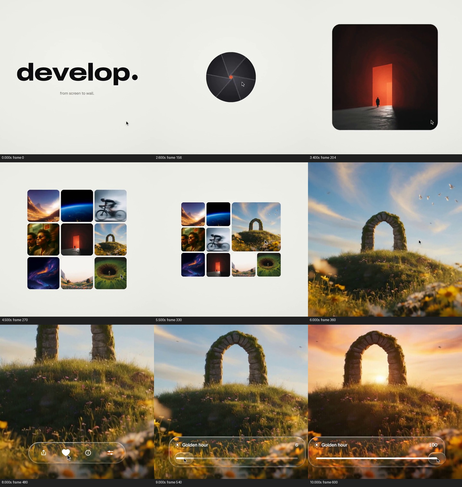

# 先让人选中一张图，再把调节结果留在同一张图上

来源：案例011《照片到手机，再到画框》，署名 twoclipping；[来源页](https://skillry.dev/ai-videos/opus-5-5/twoclipping-496100)。

范围：完整原片 [0.000, 10.200) 秒。时间均指原片；切片内时间须减去 0.000 秒。

[完整原片](../video.mp4) · [本卡完整片段](c02-restudy.mp4) · [当前拆解总览](overview.md)

观察方式与限制：frame-only：本轮重新提取并观察全片每0.5秒源帧与末帧，另核对关键局部源帧。未完成原速连续观看、慢放播放或听审；不能确认采样间隔内的完整运动、原速节奏与声画同步。技术手段和外部素材来源未经作者工程核实。

本轮依据用户指定的《创意卡拆解指令·最终修订版》重新观察、重新写作；旧创意卡正文未作为底稿。当前文件是本ID在派生索引中的唯一正文入口，保留的旧文件不代表另一张当前卡。分析结论不是作者自述，也不是观众效果实验。

## 1. 原画面具体怎样设计

这段从品牌进入图片操作。观众开头只看到暖白底上的黑色“develop.”与小字“from screen to wall.”，尚不知道后面的具体图片或调节功能。0—约2.4秒，大字让位，中心黑点展开为黑色胶囊按钮，按钮写出“Develop”，鼠标来到按钮附近。约2.4—3.6秒，按钮区域换成带叶片分割线的圆口；圆内露出暗室中的橙色发光门与小人，随后扩大为圆角方图。图片的亮门处在暗背景中，缩小时仍容易辨认；它承担“入口打开后首先发现一张作品”的作用，不是后续调色对象。

约3.6—5.2秒，这张门图缩回中间，其他图片从周围补齐三行图库：山谷、地球边缘、自行车、人像、石拱门、彩色光带、峡谷和眼睛各有不同的明暗与轮廓。暖白留白从单图的展示背景变成整个图库的承载面。鼠标移向中排右侧石拱门图；约5.2—6秒，它在图库内先变大，占掉相邻位置，其余图片缩小、重排，然后石拱门接管满幅。这里包含“认出被选中的是哪一张”的中间态，不能只写成九宫格后切一张风景。

约6—8.5秒，观众先看见草坡、石拱、云和鸟，天空出现浅色“relight.”文字。观察逐步靠近草坡上的拱门，文字退出；底部出现半透明圆角工具条，内有分享、爱心、信息、调节等图标，随后展开为更宽的滑杆。工具条贴着画面下沿，保留拱门和天空作为主要观看区域；其透明底会透出草地，强化它附着于当前图片的关系。

约8.8—10.2秒，滑杆标为“Golden hour”，数值与滑块位置一起变化：9秒附近数值较低，9.5秒附近已到高值，10秒附近到100。其间石拱仍处在同一主位置，天空和草地从较冷的日间色转为橙金色，太阳光出现在拱门洞口附近，草地的亮边和阴影也随之改变。控制条、数值、滑块和大画面共同显示一次调节，而不是分别展示四项功能。到10.2秒结果已经建立；下一段开始收走工具条并以圆形区域换入另一张图。卡在这次注意交接处结束，保留调节前提、操作和完成状态。

整段的观看组织是“先认识图片作为产品内容—在候选里认出一个对象—靠近这个对象—观察控制与结果的对应”。前半部不断改变图片的面积，6—8.5秒仍有明显的观察范围调整，8秒附近石拱顶部一度出画；到主要参数调节阶段，尤其9—10秒，主体与构图才成为相对稳定的比较参照，让注意力转到光照变化。大字只提供品牌和功能命名，鼠标与滑杆提示操作，风景自身提供可比较的变化证据。本轮未听审，不能判断是否有旁白、点击音或音乐重音；这些界面也只是片中演示，不能由此证明产品确实具有该算法或真实编辑速度。

## 2. 为什么这样设计，好在哪里

主创意是让“选择一张值得处理的图片”和“看见这张图片被改变”成为同一个观看过程。图库的作用不是堆素材，而是先建立选择范围；选中图片在原位置变大，使观众不必在切镜后重新寻找对象。随后保留石拱的形状与位置，把变化集中在天空、光源、草地色温和阴影，观众获得了一个可比较的参照。

石拱门素材直接参与设计：它的孔洞适合承接夕照亮点，天空提供大面积色温变化，草地和石块边缘能显示受光差异。如果换成没有明显明暗层次的通用色块，虽然滑杆还能移动，却无法同样具体地表现“重新打光”。太阳恰在拱门附近的安排增加了结果的可见性；这属于画面效果分析，不证明作者采用了何种生成或调色技术。

图库重排、工具条让出主体、滑杆旁保留数值是支撑设计；它们依次解决身份、观察空间和输入输出对应问题。暖白底、黑胶囊、玻璃质感、具体字体属于可替换的表面形式。圆口和图块尺寸变化可用遮罩或变换实现，但未见工程，不能声称采用了具体代码或插件。开头的孔径图形让“打开图片”有统一的形状语言，它并不比后面的操作反馈更核心。

删除选中图变大的中间态，会削弱图库到对象的连续认识；删除调节前的稳定状态，只剩夕照美图，功能便缺少比较依据；保留滑杆却让图片换了构图或主体，则容易被看成换图。反过来，移除某个装饰图标或改用不透明工具条，只要不挡住判断变化的区域，核心关系仍可成立。原片较短的结果保持能否让观众充分看清，需要原速观看确认，本轮不据抽帧评价其节奏“刚好”。

## 3. 可直接使用的创意指令

用在需要展示“选定对象后，调整一个参数会出现什么可见结果”的段落。先准备真实可用的候选图片，以及同一目标对象在调节前后的状态；两端应保持主体身份和主要构图，变化要发生在内容本身，例如同一房间的灯光、同一产品的材质或同一照片的影调。若只是概念演示，应明确其演示性质，不把生成画面当成实测结果。

先让候选集合在统一承载面上成立，给目标对象足够可辨认面积；选择发生时让目标在原位置取得更大面积，其他候选让位，然后才让它成为主要画面。不要在目标尚未辨认时直接切走。进入单图后先保留未调节状态，再把一个主要控制放到不遮住变化特征的边缘区域；控制出现前后不要同时大幅改变构图。让滑块位置、数值和对象变化保持明确对应，过程中减少额外文字，结束时收稳，给观众比较光影、纹理或结构的窗口，再进入下一项任务。

迁移时，原片“石拱—天空—夕照”的作用可映射为“商品轮廓—材质表面—粗糙度变化”：保留商品角度和轮廓，工具条只调一个参数，用高光面积与反射变化作为结果。它是有条件的设计示例，不是已取得的新素材。必须保留的是对象身份、先见基准再见变化以及控制和结果的对应；图库数量、品牌入口、色彩、工具外观和实现方式都可重做。若新素材前后视角不同、变化只能靠字幕解释，或有多个参数同时作用而无法建立对应，应改用明确的并列对照或重新补素材，放弃这套单滑杆演出。

迁移验证状态：**原片拆解（frame-only，连续观看验收未完成）**。未制作新题材样片，未验证迁移效果。
