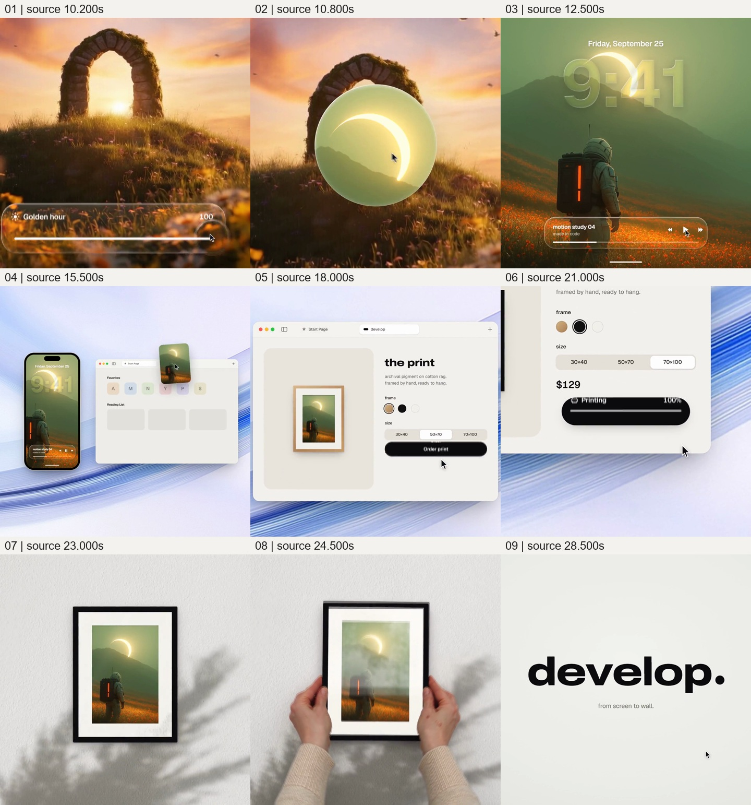
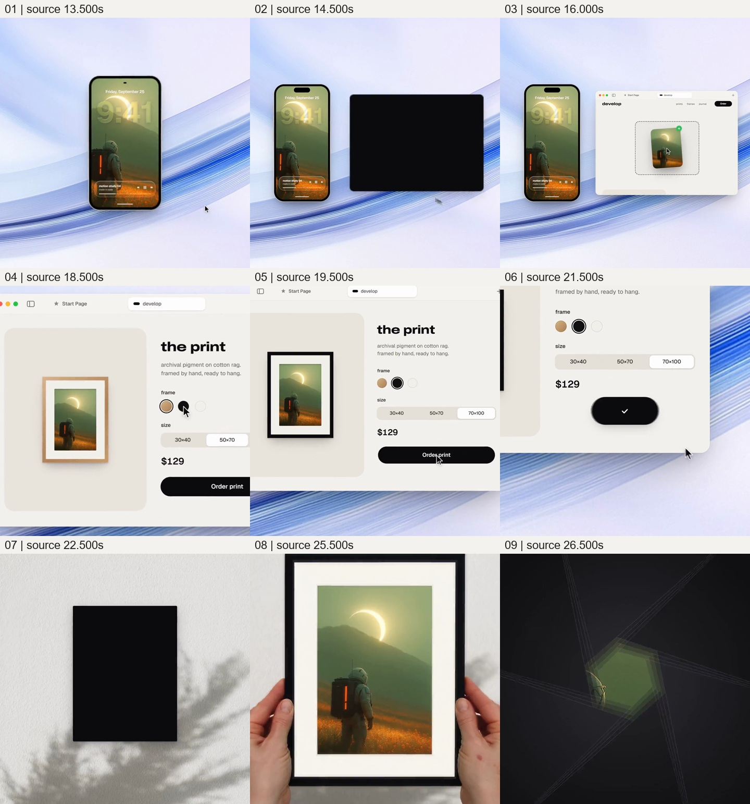

# 保留同一图像的身份，让屏幕里的喜好变成手中的画框

来源：011《照片到手机，再到画框》，作者 twoclipping；[来源页面](https://skillry.dev/ai-videos/opus-5-5/twoclipping-496100)。

完整原片：[011 原片](../video.mp4)；本卡片段：[观看片段](c02-general-redo.mp4)。

范围：原片 [10.200, 29.077) 秒，起点包含、终点不包含。

观察方式：本次核看完整原片的 64 帧总览和本卡九宫格，正文沿用此前已整理的案例创意卡，并对照上述源帧；并非本次从零重做全部观察。原卡记录了此前浏览器原速播放时的连续截图、全片每 0.5 秒源帧及关键交接加密取帧，该历史记录不冒充本轮操作。

观察限制：本次未独立完成连续原速观看；历史截图序列也不能等同逐帧连续观看。本次未实际听审，不判断音乐、音效或声画卡点。素材来源、制作技术和界面功能真实性未确认；下述迁移方法尚未在新作品中验证。

## 原画面具体怎样设计

本段起于石拱门调光完成的暖色画面，保留 0.1 秒与前卡重叠作为交接。约 10.3–11.2 秒，底部控件退出，透明圆形区域向拱洞附近移动；它先透出旧景，随后内部出现绿色天空、山脊和发光弯月状天体，再扩大接管全幅。新图下部是橙色花地和背向观众的宇航员，背包有橙红亮带。这里明确换了图片，之后跨载体保留的是这张宇航员图。

先有画面，再有载体身份：约 12 秒，日期和大号半透明 `9:41` 叠入上方，下方出现带 `motion study 04`、`made in code` 与播放图标的播放器。直到约 13.5 秒，整个图面缩入黑色手机边框，蓝白流线状桌面背景才露出。观众先认识图像，再发现它处于手机锁屏；手机向左让位，右侧出现黑色圆角矩形，并建立为浏览器起始页。

约 15–16 秒，宇航员图作为独立小卡从手机区域浮起，移向右侧网页，在虚线接收区域出现，旁边带绿色加号。手机、飞行中的图卡与网页短暂同场，交代了内容从哪里来、到哪里去。随后网页成为主角，手机移到左边并被裁出。页面上先出现 `from screen to wall.` 与同图，再进入 `the print` 区域：左侧是木色边框、白色卡纸和宇航员图，右侧提供框色、尺寸、价格及 `Order print`。

约 18.5–19.5 秒，指针选择黑色框，预览的外框相应变黑，尺寸选项也改变；同图继续保留在白卡纸内。之后黑色按钮经历转圈、`Ordered`、`Printing 100%` 和勾号胶囊等状态。约 22 秒黑色遮挡占满画面，随后露出带纹理与枝叶投影的白墙和中央黑矩形；黑矩形显出黑边、白卡纸及同一宇航员图，成为墙面上的相框。

双手从下方两侧进入，握住框边，相框与手逐渐靠近观看位置。约 24.5 秒玻璃反光明显经过图面，随后图像重新较清楚地显露。这里有墙面纹理、枝叶阴影、框的厚度、手指遮挡与表面反光，图像不再只是悬空的矩形。相框继续靠近，最后宇航员和发光天体的局部近乎填满画幅；暗色光圈状叶片收合，回到暖白底黑胶囊，再回到 `develop.` 和标语，结束整片。

补充分镜源时间：13.500、14.500、16.000、18.500、19.500、21.500、22.500、25.500、26.500 秒。它补足手机与网页同场、接收图卡、配置改变、状态收束以及实体画框接管的中途状态；主九宫格仍保留完整入口与片尾。

## 为什么这样设计，好在哪里

主创意是让同一图像的用途发生连续升级：先是值得观看的画面，再是个人屏幕上的内容、可以转移的文件、能够配置的商品，最后是可以握持的装裱物。每次变化都保留宇航员、亮带、山脊和发光天体等识别线索，同时改变它周围的边界和行为。图像承担身份延续，手机、网页、卡纸、框和双手分别说明它现在处于哪一种使用关系。

“先内容、后容器”的顺序有两次作用。第一次让观众先看见图像，再从手机边框的出现理解它是锁屏；第二次让网页中的装裱预览先建立目标样式，再用墙面和双手补出它作为实体物件的尺度与表面。若开头就是两台设备并排，画面容易成为功能列表；若直接从手机切到墙面成品，则省略了内容转移、配置与结果之间的联系。原片通过实际可见的接力动作，把标语中的“从屏幕到墙面”展开为过程。

手机左移是为目标网页留位置，图卡跨越两者是交接的主体；当接收完成，网页扩大，手机退场，注意力才从“怎样过去”转到“会变成什么”。装裱阶段保留图像而改变框色与比例，让可配置的对象指向清楚。订单文字只是过程状态提示，完成后让位给成品；如果最后只留下一个完成勾号，仍不能产生同等的拥有感。

实体质感也不是可有可无的装饰。白卡纸使内容与边框分层，墙与投影建立放置环境，双手给出尺度及握持关系，玻璃反光说明表面覆盖在图像之前。这些可见线索共同把网页矩形转成片内呈现的物件。任意图标替换双手或反光会损失这种关系。但仅凭画面不能认定它是实拍、真实打印或实际履约过程，订单与价格也只按作品内状态记录。

黑胶囊、圆形换图和光圈收合使入口、状态与品牌收尾相互呼应，是支撑设计；主线仍是图像身份与用途的变化。宇航员题材、绿色天空、黑色框和具体设备皮肤可以替换。跨载体识别、可理解的传递动作以及最后可观察的使用结果，才是这套设计成立的条件。末尾让实体物靠近后重新回到图像局部，也使品牌收尾承接已形成的结果，而非突然插入无关标版。

## 可直接使用的创意指令

当新作品要表现“这份内容如何进入生活或成为成果”，先选一份在多个阶段都能被辨认的真实内容，并明确起点用途与终点用途。可以是照片到装裱、设计稿到样品、记录到可使用的成品；不要因为都能画成矩形，就把没有真实关系的文件、商品和场景串在一起。为每个阶段准备匹配的内容版本、载体和必要的操作材料，确保观众可以追踪同一对象。

先建立内容的吸引力或价值，再揭示它当前的承载方式。发生转移时让起点与终点有一段可读的共存：源容器让出空间，内容成为可移动对象，目标容器给出接收位置或接收反应。内容进入以后，目标取得主要面积，源容器才退出。直接迁移可以沿用图卡转移；结构迁移也可让真实样品、数据记录或设计部件承担交接，动作必须与该材料的实际用途相符。

每次更换载体都回答一个新问题：在哪里使用、如何转入、如何定制、最终获得什么。配置阶段保留内容，明确改变的是外框、尺寸或其他真实属性，操作提示与可见结果相互对应。只保留帮助理解的状态文字；实际耗时未核实时，可以表现概念流程或明确的时间省略，不用极短进度动画暗示服务速度已被验证。

到终点时，要用材料本身建立使用或拥有的结果。选择能给出尺度、接触、厚度、表面或所在环境的画面，让内容与新载体共同被观察；若是实体成果，可以由手部动作和表面光影证明片内的物件关系，若是数字成果，则展示它实际进入工作或生活场景后的用途。不能只用一个完成图标收尾。

载体外观、转场形状、背景颜色和题材均可换，顺序与停留按新内容重排；保留身份线索、交接可读性和终点使用价值。没有终点材料时缩小表述范围，落在已能展示的结果；跨阶段内容无法保持对应时，改用明确的阶段对照，放弃伪装成同一对象连续变形。原片的换图入口可删，不能迁移成“前一张图自动变为后一张成品”的错误因果。
