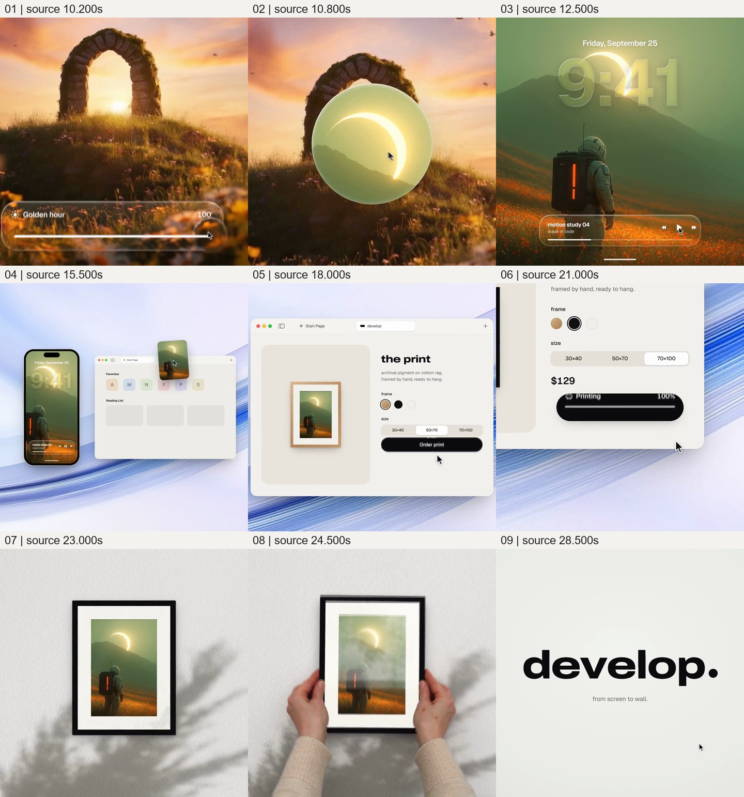
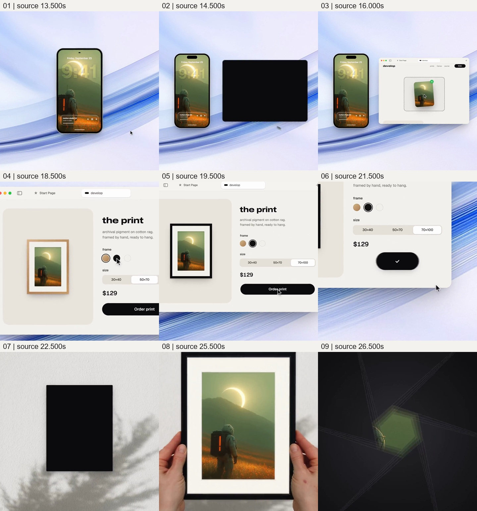

# 保留同一图像的身份，让屏幕里的喜好变成手中的画框

来源：011《照片到手机，再到画框》，作者 twoclipping；[来源页面](https://skillry.dev/ai-videos/opus-5-5/twoclipping-496100)。

完整原片：[011 原片](../video.mp4)；本卡片段：[观看片段](c02-general-redo.mp4)。

范围：原片 [10.200, 29.077) 秒，起点包含、终点不包含。

观察方式：本次核看完整原片的 64 帧总览和本卡九宫格，正文沿用此前已整理的案例创意卡，并对照上述源帧；并非本次从零重做全部观察。原卡记录了此前浏览器原速播放时的连续截图、全片每 0.5 秒源帧及关键交接加密取帧，该历史记录不冒充本轮操作。

观察限制：本次未独立完成连续原速观看；历史截图序列也不能等同逐帧连续观看。本次未实际听审，不判断音乐、音效或声画卡点。素材来源、制作技术和界面功能真实性未确认；下述迁移方法尚未在新作品中验证。

## 原画面具体怎样设计

本段起于石拱门调光完成的暖色画面，保留 0.1 秒与前卡重叠作为交接。约 10.3–11.2 秒，底部控件退出，透明圆形区域向拱洞附近移动；它先透出旧景，随后内部出现绿色天空、山脊和发光弯月状天体，再扩大接管全幅。新图下部是橙色花地和背向观众的宇航员，背包有橙红亮带。这里明确换了图片，之后跨载体保留的是这张宇航员图。

先有画面，再有载体身份：约 12 秒，日期和大号半透明 `9:41` 叠入上方，下方出现带 `motion study 04`、`made in code` 与播放图标的播放器。直到约 13.5 秒，整个图面缩入黑色手机边框，蓝白流线状桌面背景才露出。观众先认识图像，再发现它处于手机锁屏；手机向左让位，右侧出现黑色圆角矩形，并建立为浏览器起始页。

约 15–16 秒，宇航员图作为独立小卡从手机区域浮起，移向右侧网页，在虚线接收区域出现，旁边带绿色加号。手机、飞行中的图卡与网页短暂同场，交代了内容从哪里来、到哪里去。随后网页成为主角，手机移到左边并被裁出。页面上先出现 `from screen to wall.` 与同图，再进入 `the print` 区域：左侧是木色边框、白色卡纸和宇航员图，右侧提供框色、尺寸、价格及 `Order print`。

约 18.5–19.5 秒，指针选择黑色框，预览的外框相应变黑，尺寸选项也改变；同图继续保留在白卡纸内。之后黑色按钮经历转圈、`Ordered`、`Printing 100%` 和勾号胶囊等状态。约 22 秒黑色遮挡占满画面，随后露出带纹理与枝叶投影的白墙和中央黑矩形；黑矩形显出黑边、白卡纸及同一宇航员图，成为墙面上的相框。

双手从下方两侧进入，握住框边，相框与手逐渐靠近观看位置。约 24.5 秒玻璃反光明显经过图面，随后图像重新较清楚地显露。这里有墙面纹理、枝叶阴影、框的厚度、手指遮挡与表面反光，图像不再只是悬空的矩形。相框继续靠近，最后宇航员和发光天体的局部近乎填满画幅；暗色光圈状叶片收合，回到暖白底黑胶囊，再回到 `develop.` 和标语，结束整片。

补充分镜源时间：13.500、14.500、16.000、18.500、19.500、21.500、22.500、25.500、26.500 秒。它补足手机与网页同场、接收图卡、配置改变、状态收束以及实体画框接管的中途状态；主九宫格仍保留完整入口与片尾。

## 为什么这样设计，好在哪里

主创意是让同一图像的用途发生连续升级：先是值得观看的画面，再是个人屏幕上的内容、可以转移的文件、能够配置的商品，最后是可以握持的装裱物。每次变化都保留宇航员、亮带、山脊和发光天体等识别线索，同时改变它周围的边界和行为。图像承担身份延续，手机、网页、卡纸、框和双手分别说明它现在处于哪一种使用关系。

“先内容、后容器”的顺序有两次作用。第一次让观众先看见图像，再从手机边框的出现理解它是锁屏；第二次让网页中的装裱预览先建立目标样式，再用墙面和双手补出它作为实体物件的尺度与表面。若开头就是两台设备并排，画面容易成为功能列表；若直接从手机切到墙面成品，则省略了内容转移、配置与结果之间的联系。原片通过实际可见的接力动作，把标语中的“从屏幕到墙面”展开为过程。

手机左移是为目标网页留位置，图卡跨越两者是交接的主体；当接收完成，网页扩大，手机退场，注意力才从“怎样过去”转到“会变成什么”。装裱阶段保留图像而改变框色与比例，让可配置的对象指向清楚。订单文字只是过程状态提示，完成后让位给成品；如果最后只留下一个完成勾号，仍不能产生同等的拥有感。

实体质感也不是可有可无的装饰。白卡纸使内容与边框分层，墙与投影建立放置环境，双手给出尺度及握持关系，玻璃反光说明表面覆盖在图像之前。这些可见线索共同把网页矩形转成片内呈现的物件。任意图标替换双手或反光会损失这种关系。但仅凭画面不能认定它是实拍、真实打印或实际履约过程，订单与价格也只按作品内状态记录。

黑胶囊、圆形换图和光圈收合使入口、状态与品牌收尾相互呼应，是支撑设计；主线仍是图像身份与用途的变化。宇航员题材、绿色天空、黑色框和具体设备皮肤可以替换。跨载体识别、可理解的传递动作以及最后可观察的使用结果，才是这套设计成立的条件。末尾让实体物靠近后重新回到图像局部，也使品牌收尾承接已形成的结果，而非突然插入无关标版。

## 完整照排指令

以[完整原片](../video.mp4)的 10.2–29.077 秒为准。画幅 1280×1280，源帧率 60/1。以下拍点为抽帧定位，位置按画幅百分比取近似值。

### 用料

- 【贯穿图像】提供无字高分辨率原图，主体、远景光源和两层主要色面在全幅、竖屏和印刷裁切里都可辨认。备同图的【锁屏预览】【网页图卡】【装裱预览】【实物画框】，各阶段允许不同裁幅，主体与地标不得挪位。【前场调光图】用于圆形转接。【波纹背景】用浅蓝底与斜向蓝细纹。
- 【锁屏日期】【锁屏时间】【锁屏控制】【网页标题】【页面副句】【装裱标题】【选项字段】【订单金额】【订单按钮】【订单状态】【品牌字】【品牌小注】取对应页面和短句。真实下单、打印及交付附操作记录、订单来源和实物实拍。【上墙取画】需有同一尺寸画框、墙面和双手握住画框再取下的连续动作。

### 按源时刻摆放

1. **10.200–约 13.000 秒。** 从暖色【前场调光图】全幅开始。中间透明圆先只替换局部，绿金【贯穿图像】经圆边越过拱口再接全幅。上半保留月牙、斜山线，下半保留暗人物和暖橙地。顶部渐显小【锁屏日期】与特大淡色【锁屏时间】，下方薄透明【锁屏控制】稍后出现。字固定在屏幕，允许源图定格。
2. **约 13.000–16.500 秒。** 全幅图连同锁屏字缩进细黑手机壳，背景转冷淡【波纹背景】。手机从中轴让向左侧，宽约四分之一，保持【锁屏预览】，不换壁纸。右侧先出现近黑矩形，旋即亮成白网页。由手机附近的【网页图卡】移进或在网页图片区对应落位。手机到位后一直留到网页占主幅。底图可静态缓移，手机和网页内用同一图，禁止用近似图代替。
3. **约 16.500–19.700 秒。** 白网页成为主幅，保留顶部细导航。左边用粗黑两行【网页标题】和小灰【页面副句】，右半摆大幅【网页图卡】。切到下部配置页，左边【装裱预览】，右边黑粗【装裱标题】及两三行【选项字段】、材料小圆样与尺寸小按钮。依次换框色，图像及白色卡纸不变。右下独立较粗【订单金额】和宽黑胶囊【订单按钮】。
4. **约 19.700–22.200 秒。** 配置页向右下聚焦，框图仍留在左，胶囊内由操作词切到带勾结果及细进度条【订单状态】。进度在原位置变化，禁止清空装裱预览后再假接新成果。可用同一网页静态分层；真状态保留可检记录。末拍黑场把网页与实体隔开。
5. **约 22.200–26.300 秒。** 浅墙和叶影建立，中心先见黑矩形，随后读成黑边白衬的【实物画框】，画像仍为【贯穿图像】。从两侧下方进双手并握左右边，随【上墙取画】略提或向镜前移。画框从上墙状态持续到取下近景。手需真实抓握，不用静照运镜补握持过程。随后画内图沿同一主体放大接满画幅，墙面与手退出。
6. **约 26.300–29.077 秒。** 图像退让给浅灰白底，中央短黑胶囊归为黑粗【品牌字】，小【品牌小注】随后落于下方。按 29.077 秒在品牌留读中切出。

### 局部采用

只具备同源数字图和锁屏可用 10.200–约 16.500 秒。只有可验证的网页配置及实物时，可用约 16.500–26.300 秒。没有同一图的实体时，只可采用约 16.500–22.200 秒的数字配置，不能把网页预览表述为已经交付。

### 验证状态

已对照每秒两帧原片画序并读回，核对圆内转接、锁屏与网页同场、选框及下单过程中图像不换、手实际取框和末段放大。精确切帧、进度语义、原速听看和换料试摆待核。
