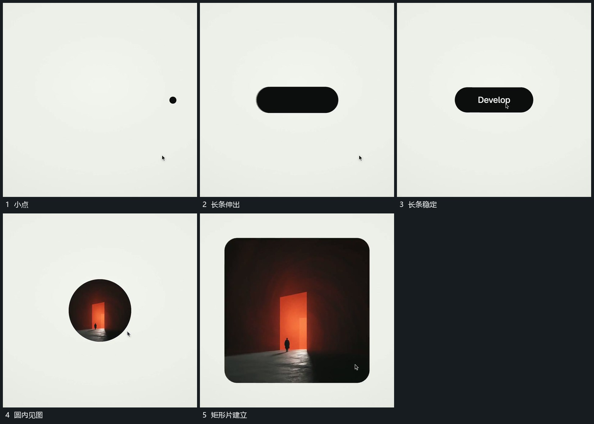

# 小点伸成长条，圆口显图后扩大成片

## 运动指令

先将中心小点横向伸成短长条，文字在条内建立。退出后在原焦点用圆形可见区域显示新图，再扩大到竖向矩形范围，内部内容保持可辨认。

## 视频切片

[播放本机制的原片切片](m01.mp4)

覆盖分镜中“小点”至“矩形片建立”的连续过程，并保留邻近的前后衔接画面；原片中交叠发生的动作一并保留。

## 分镜过程

## 组合与调整

这是连续接点与范围更换，不指定长条到图像的真实几何变形。
