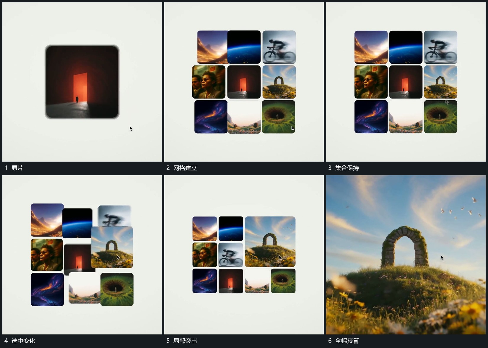

# 网格围绕原片补齐，选中格扩大接管全幅

## 运动指令

围绕原片补入其他图块形成网格，已有片仍留在其中。选中一格后相邻块让位，该格变大并接管全幅，其内部图像继续。

## 视频切片

[播放本机制的原片切片](m02.mp4)

覆盖分镜中“原片”至“全幅接管”的连续过程，并保留邻近的前后衔接画面；原片中交叠发生的动作一并保留。

## 分镜过程

## 组合与调整

可改选中位置，保留它来自网格的过程；只补必要数量。
