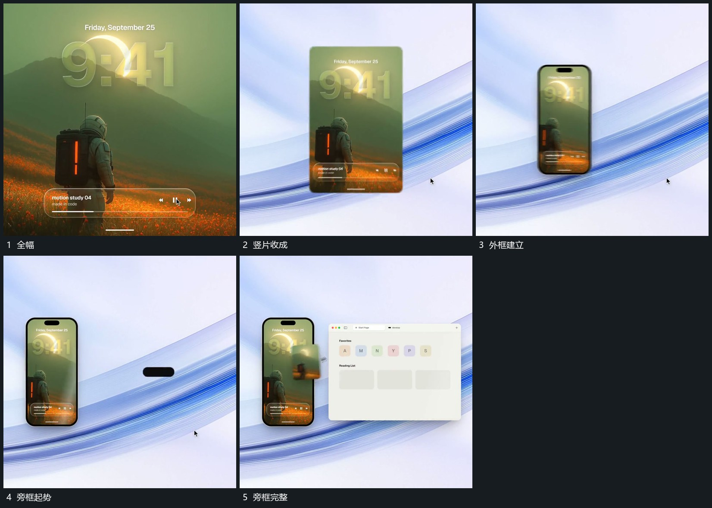

# 全幅收成竖片，旁侧大框接力建立

## 运动指令

将全幅内容收成竖片，外框接入并保留内部画面。随后在旁侧空位建立较大的框，原竖片位置保持，新框内部逐项建立。

## 视频切片

[播放本机制的原片切片](m05.mp4)

覆盖分镜中“全幅”至“旁框完整”的连续过程，并保留邻近的前后衔接画面；原片中交叠发生的动作一并保留。

## 分镜过程

## 组合与调整

可改并置方向；不要收缩到看不清，旁框进入时给原片留识别空间。
