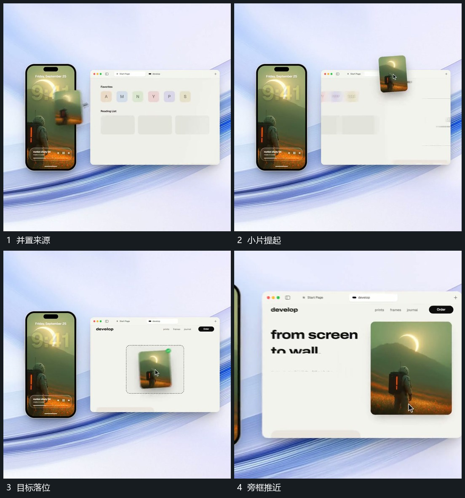

# 小片从竖框附近提起，跨到旁框目标空位

## 运动指令

从竖框附近提起独立小片，向旁侧大框移动，途中保留倾角，到目标空位后转正落入，目标边界给出确认。原竖框仍在，随后大框推近接管。

## 视频切片

[播放本机制的原片切片](m06.mp4)

覆盖分镜中“并置来源”至“旁框推近”的连续过程，并保留邻近的前后衔接画面；原片中交叠发生的动作一并保留。

## 分镜过程

## 组合与调整

保持来源和目标可追踪；可以采用副本，不必把原图从来源挖空。
