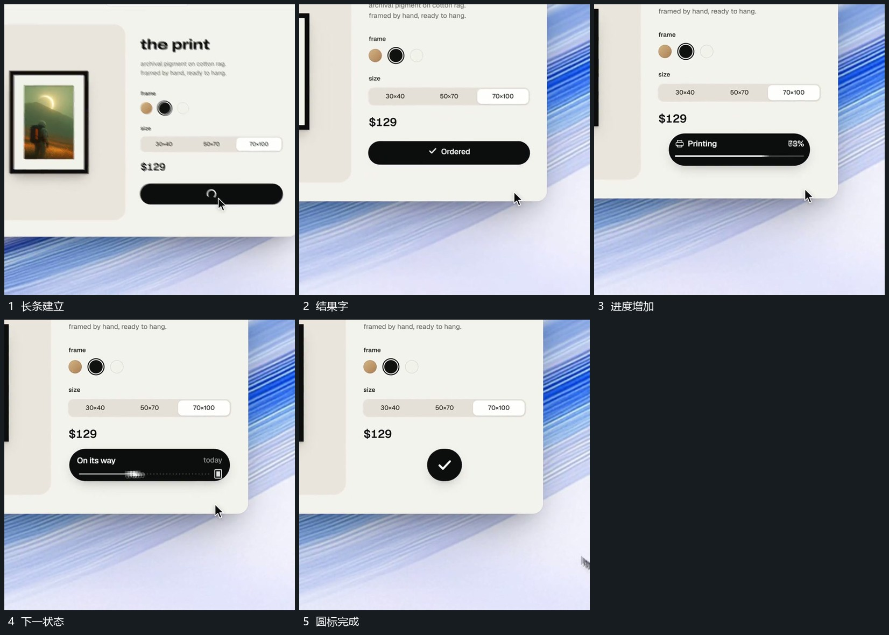

# 长条内部更新进度，最后收成圆形完成标记

## 运动指令

保持长条范围，内部文字先更换为处理状态，再随进度增长更新。完成后附属内容退出，长条收成圆形，中央完成形接入并留下。

## 视频切片

[播放本机制的原片切片](m07.mp4)

覆盖分镜中“长条建立”至“圆标完成”的连续过程，并保留邻近的前后衔接画面；原片中交叠发生的动作一并保留。

## 分镜过程

## 组合与调整

可简化中间状态，保留由处理到完成的接续；结果标记不要无来源地单独闪现。
