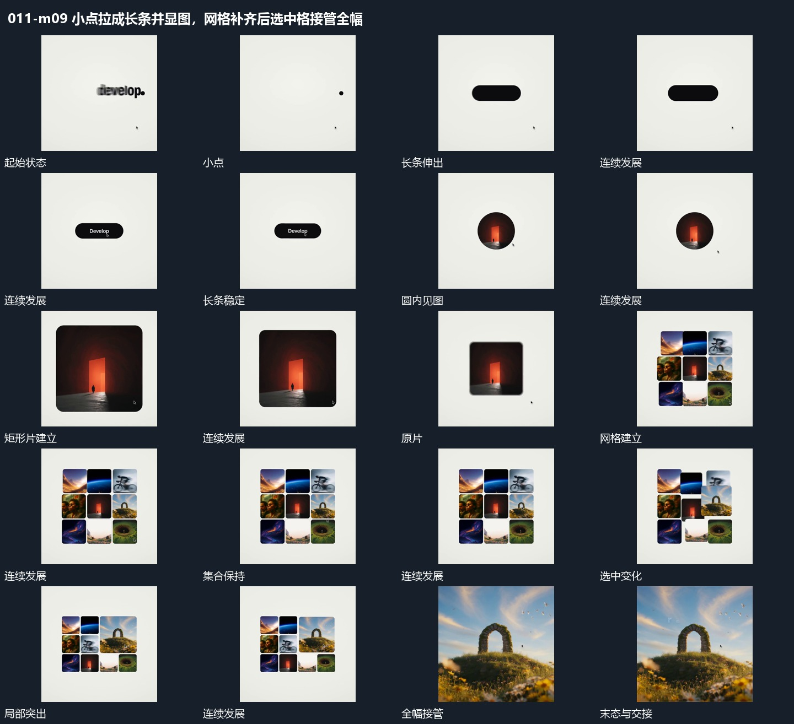

# 小点拉成长条并显图，网格补齐后选中格接管全幅

## 运动指令

形状先从点发展为图块，周围网格继续补齐；选中格再扩大，完成由局部建立到全幅接管的演出。

1. **小点伸成长条，圆口显图后扩大成片**

先将中心小点横向伸成短长条，文字在条内建立。退出后在原焦点用圆形可见区域显示新图，再扩大到竖向矩形范围，内部内容保持可辨认。

2. **网格围绕原片补齐，选中格扩大接管全幅**

围绕原片补入其他图块形成网格，已有片仍留在其中。选中一格后相邻块让位，该格变大并接管全幅，其内部图像继续。

整段结束：选中内容成为全幅 保留必要落稳与交接，中间已建立的参照沿用到下一步骤。

## 视频切片

[播放本机制的原片切片](m09.mp4)

保留起始准备、连续发展和完成或明确交接；首尾按本段运动范围裁切，不拼接、不变速。相连的小动作合为同一完整段落。

## 分镜过程

## 组合与调整

形状先从点发展为图块，周围网格继续补齐；选中格再扩大，完成由局部建立到全幅接管的演出。 复用时可调整元素数量、幅度和相对节奏，保留上述进入、交叠与完成关系；不直接沿用原片题材或时长。

这是连续接点与范围更换，不指定长条到图像的真实几何变形。

可改选中位置，保留它来自网格的过程；只补必要数量。
