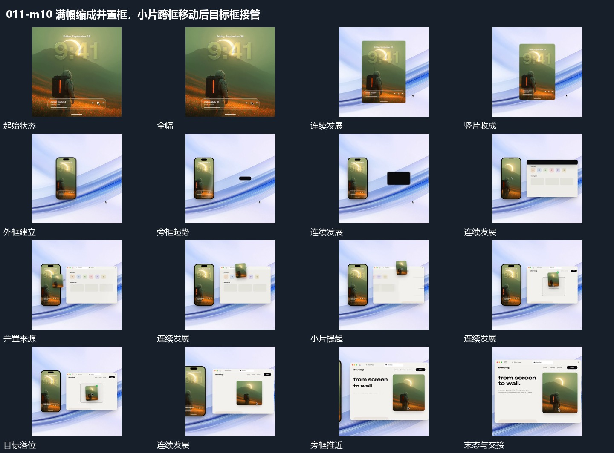

# 满幅缩成并置框，小片跨框移动后目标框接管

## 运动指令

先建立源竖框与旁侧目标框，再提起局部跨越两框，落入目标后目标框扩大接管。

1. **全幅收成竖片，旁侧大框接力建立**

将全幅内容收成竖片，外框接入并保留内部画面。随后在旁侧空位建立较大的框，原竖片位置保持，新框内部逐项建立。

2. **小片从竖框附近提起，跨到旁框目标空位**

从竖框附近提起独立小片，向旁侧大框移动，途中保留倾角，到目标空位后转正落入，目标边界给出确认。原竖框仍在，随后大框推近接管。

整段结束：小片落入旁框，目标边界确认 保留必要落稳与交接，中间已建立的参照沿用到下一步骤。

## 视频切片

[播放本机制的原片切片](m10.mp4)

保留起始准备、连续发展和完成或明确交接；首尾按本段运动范围裁切，不拼接、不变速。相连的小动作合为同一完整段落。

## 分镜过程

## 组合与调整

先建立源竖框与旁侧目标框，再提起局部跨越两框，落入目标后目标框扩大接管。 复用时可调整元素数量、幅度和相对节奏，保留上述进入、交叠与完成关系；不直接沿用原片题材或时长。

可改并置方向；不要收缩到看不清，旁框进入时给原片留识别空间。

保持来源和目标可追踪；可以采用副本，不必把原图从来源挖空。
