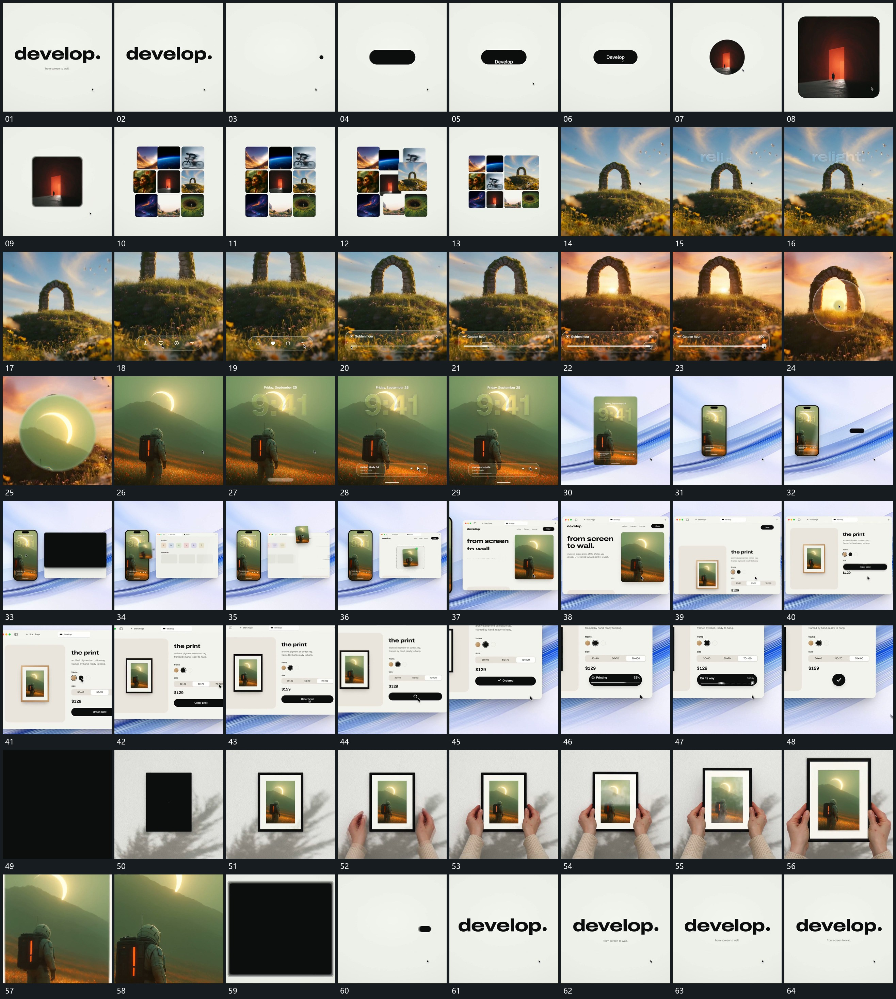

# 011｜原片运动总览

[观看完整原片](video.mp4)

## 运动总览

开头大字退出，小点伸成长条，圆口显图后扩大成片 让小点伸成长条，再借圆形可见区域接入新图，扩大成矩形片。网格围绕原片补齐，选中格扩大接管全幅 围绕该片补成网格，突出其中一格并由其画面接管全幅。

全幅上 指示形沿底部长条推进，内部状态连续改变 保持图像参照，指示形沿横条推进，内部状态连续更换。随后 局部圆口露出新层，放大后接管原场 在局部打开圆形新层，扩大后接入下一全幅。新场中的大数字与下方短条建立，全幅收成竖片，旁侧大框接力建立 把满幅收成竖片并接入旁侧大框。

中段 小片从竖框附近提起，跨到旁框目标空位 从竖片附近提起小片，跨到旁框的目标空位，再由大框推近接管。框内继续复用局部选项更新，长条内部更新进度，最后收成圆形完成标记 让长条更换状态、增加进度并收成圆形完成标记。后段 同形框匹配到新底层，侧边前景接住后推近 让同形框在新底层建立，靠近的前景从两侧接住框边，整体推近后回到长条与大字收尾。

## 完整运动段落

以下按原片中的出现顺序引用。建立、内部发展及完成反馈放在同一段中；同时发生的局部动作与运镜写在同一份指令里。不同段之间可以是连续接管，也可以是直接切换，不能仅凭条目相邻认定可直接拼接。重复出现的同类运动采用一次连续代表范围，切片不以逐段无缝覆盖整片为目标。

1. [小点拉成长条并显图，网格补齐后选中格接管全幅](mechanisms/m09.md)：形状先从点发展为图块，周围网格继续补齐；选中格再扩大，完成由局部建立到全幅接管的演出。

2. [指示形沿底部长条推进，内部状态连续改变](mechanisms/m03.md)：位置推进与内部变化同步，主构图保持

3. [局部圆口露出新层，放大后接管原场](mechanisms/m04.md)：新层先在圆内可见，再扩大覆盖旧层

4. [满幅缩成并置框，小片跨框移动后目标框接管](mechanisms/m10.md)：先建立源竖框与旁侧目标框，再提起局部跨越两框，落入目标后目标框扩大接管。

5. [长条内部更新进度，最后收成圆形完成标记](mechanisms/m07.md)：外条保持时内部更新，完成后整体收小

6. [同形框匹配到新底层，侧边前景接住后推近](mechanisms/m08.md)：换底保留框形锚点，前景从两侧接近边缘

切片保留起始准备、必要内部停顿和完成或明确交接；首尾省略无新发展的等待，持续运动不要求人为停住。以上基于真实源帧序列和重点边界核对，不等同于全片连续声画审片。

## 完整64宫格

