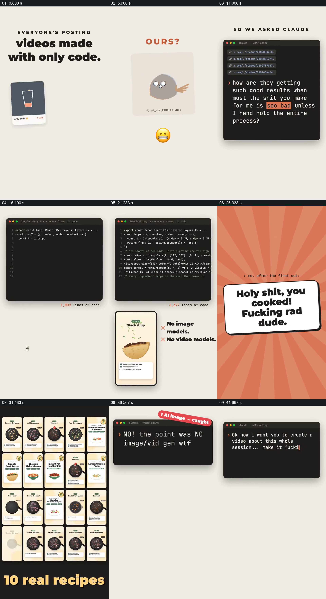

# 从作品落差发起请求，用代码、成果集合和自我回指讲完整制作过程

- 作品：案例 031《代码制作餐食图解的过程说明》（库内索引名称）。
- 原片范围：00:00.000–00:46.000，含起点、不含终点；[完整原片](../video.mp4)｜[本卡片段](c01.mp4)。
- 范围依据：从他人作品和自身结果对照，到大量食谱成果、纠错和当前影片的回指；随后为技术声明与收尾。
- 观察方式与未确认范围：查看整片 64 帧总览和本卡分镜。未独立完成连续原速观看与听审；抽帧之间的运动、停顿与声音配合待复核。画面中的界面、数字与说明是作品呈现，未经额外核实；设计价值为基于画面的分析。

## 原画面具体怎样设计

浅色竖屏上先有“大家都在发布只用代码做的视频”，下方依次出现饮料、彩条和柱状图形式的示例卡。随后橙色“OURS?”下面换成一张简陋小角色和尴尬表情；黑色终端窗口接着占据上方，列出参考链接与一段询问结果为何不佳的文字。

深色放射背景上的“Hold on. Let me cook.”把请求接到制作。回到浅色画面后，终端代码和行数位于上方，下面一部手机中依次显示锅、食材和餐食页面，旁边写没有图像及视频模型、只有代码。橙色放射背景的夸张反馈卡之后，多张小型食谱视频卡在黑底上排成密集矩阵，底部依次显示钩子、食谱和视频数量。

之后终端显示对一张 AI 图片的纠正，下方出现标注为重新用代码绘制的人物插图；最后另一条终端请求要求制作关于整个过程的视频，旁边手机中的画面出现片头的示例布局，形成影片讲述自己如何被要求制作的回扣。

## 为什么这样设计，好在哪里

开头不是抽象宣称能力，而是把参照作品与不满意结果并置，让后续终端请求有具体动机。代码窗口与手机产物上下相邻，使制作过程和视觉结果可同时被看到；矩阵把单份食谱扩展为可感知的规模，纠错片段则保留过程中的偏差。结尾回到相同片头，把正在观看的影片也纳入故事。

代码行数、模型使用方式和作品数量均为片中展示，本次未独立核实；静帧也不能证明真正的生成过程。

## 可直接使用的创意指令

如果制作过程本身值得讲，先并置有代表性的目标与当前结果，再呈现一条真实问题或制作要求。把可公开的工作界面与具体产物保持邻近，让一次产出先可辨认，再展示多次结果；如确有有价值的错误及修订，保留前因和修正。最后可让作品自身成为回扣，但不必强行做循环。

终端可换成草稿、摄影现场或编辑界面，集合形态和幽默程度可重设；保留问题、过程、结果及修订的事实关系，不把模拟界面或未经核实的统计写成证明。

本方法尚未在新题材中实测。
